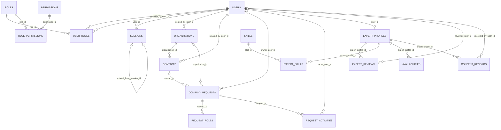
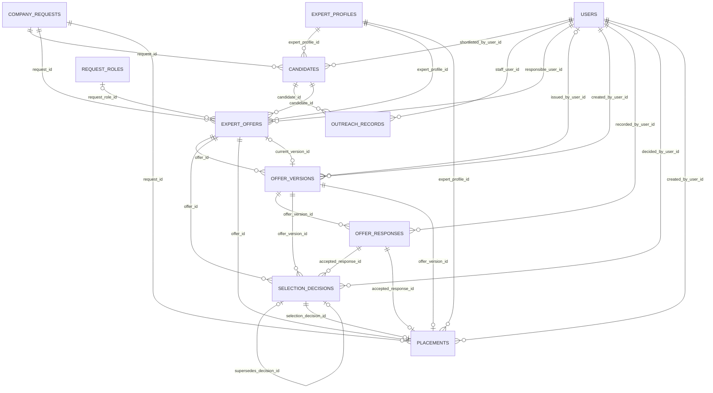

# DevMasters — Database Dictionary and Relationships

**Version:** 1.0 — proposed physical design  

**Date:** 1 November 2026  

**Basis:** user-supplied `Pasted markdown(3).md`, the accepted agency architecture.

## 1. Scope and interpretation

This design preserves the accepted agency model: anonymous company requests, an Admin portal and a portal for approved experts, manual matching, individual versioned offers, exact-version expert responses, separate DevMasters selection, and administrative placement history. There are no company accounts, project tasks, timesheets or deliverable-management tables. Experts work directly with the requesting company. [S1 §§1–3]

**Provenance:** the source defines 33 ER entities and core workflow requirements, not an exact physical schema. All column names, types, lengths, defaults, exact enum sets and nine supporting/refinement tables below are proposed implementation details. They are not claimed to be previously approved or deployed. No live database, Prisma schema or migration set was provided. [S1 §3]

**Inventory:** 42 tables (33 source ER entities + 9 supporting refinements), 442 physical columns, 80 simple foreign-key relationships, 37 controlled vocabularies, 30 integrity specifications and 20 planned acceptance tests.

## 2. Conventions

`PK` = primary key; `FK` = foreign key; `UQ` = single-column uniqueness. Multiple PK-marked identifiers on a junction form one composite primary key. UUIDs are supplied by the application. Table names are plural snake_case. Calendar dates use `date`; event times use `timestamptz(3)`, with UTC at application boundaries. Monetary amounts use `numeric(18,2)`. Types and Prisma native attributes must be pinned to installed versions. [T2]

“Nullable” describes database nullability; offer drafts may omit values that become mandatory before issuance. “None” means no default, not optionality. `updated_at` and `record_version` must be maintained by every authorized write path. `record_version` is an optimistic-concurrency integer and is not the offer revision number.

Default foreign-key actions are proposed as `ON DELETE RESTRICT` and `ON UPDATE RESTRICT`. Routine operations disable/archive masters rather than erase history. This is not a legal retention schedule: final retention, consent wording and privileged purge procedures remain unresolved. Logical target IDs in audit/outbox/idempotency records are explicitly not database-enforced polymorphic foreign keys.

## 3. Table catalogue

| Module | Table | Source entity | Origin | Columns | Purpose |
|---|---|---|---|---|---|
| 01 Identity and access | users | USER | Core ER entity | 12 | Admin/staff and approved-expert authentication accounts. |
| 01 Identity and access | roles | ROLE | Core ER entity | 9 | Named groups of staff or expert permissions. |
| 01 Identity and access | permissions | PERMISSION | Core ER entity | 5 | Atomic actions checked by backend authorization. |
| 01 Identity and access | user_roles | USER_ROLE | Core ER entity | 4 | Many-to-many account-to-role assignments. |
| 01 Identity and access | role_permissions | ROLE_PERMISSION | Core ER entity | 3 | Many-to-many role-to-permission assignments. |
| 01 Identity and access | sessions | SESSION | Core ER entity | 13 | Refresh-session records and rotation history. |
| 02 Company intake and CRM | organizations | ORGANIZATION | Core ER entity | 11 | Verified internal company records; not login accounts. |
| 02 Company intake and CRM | contacts | CONTACT | Core ER entity | 12 | Internal contact persons belonging to an organization. |
| 02 Company intake and CRM | company_requests | COMPANY_REQUEST | Core ER entity | 22 | Anonymous Invite Us to Bid and Hire Our Team submissions and agency follow-up. |
| 02 Company intake and CRM | request_roles | REQUEST_ROLE | Core ER entity | 11 | Roles/headcount needed under one company request. |
| 02 Company intake and CRM | request_activities | REQUEST_ACTIVITY | Core ER entity | 10 | Append-only agency notes and request activity history. |
| 03 Expert network | expert_profiles | EXPERT_PROFILE | Core ER entity | 18 | Public application and, after approval, the expert profile. |
| 03 Expert network | expert_reviews | EXPERT_REVIEW | Core ER entity | 10 | Immutable application review decisions and reviewed evidence. |
| 03 Expert network | skills | SKILL | Core ER entity | 8 | Controlled skill catalogue used for manual matching. |
| 03 Expert network | expert_skills | EXPERT_SKILL | Core ER entity | 6 | Expert-to-skill many-to-many association. |
| 03 Expert network | availabilities | AVAILABILITY | Core ER entity | 10 | Expert availability intervals for manual staff search. |
| 03 Expert network | consent_records | CONSENT_RECORD | Core ER entity | 11 | Append-only expert consent and withdrawal events. |
| 04 Matching and outreach | candidates | CANDIDATE | Core ER entity | 10 | One manual shortlist record per expert per request. |
| 04 Matching and outreach | outreach_records | OUTREACH_RECORD | Core ER entity | 9 | Append-only history of staff contact with shortlisted experts. |
| 05 Offers and placements | expert_offers | EXPERT_OFFER | Core ER entity | 12 | One DevMasters-to-expert offer, distinct from final selection. |
| 05 Offers and placements | offer_versions | OFFER_VERSION | Core ER entity | 26 | Versioned terms and operational state of one expert offer. |
| 05 Offers and placements | offer_responses | OFFER_RESPONSE | Core ER entity | 10 | Immutable expert response to an exact issued offer version. |
| 05 Offers and placements | selection_decisions | SELECTION_DECISION | Core ER entity | 10 | Append-only DevMasters selection decisions, separate from acceptance. |
| 05 Offers and placements | placements | PLACEMENT | Core ER entity | 17 | Administrative record of a selected expert working directly with the company. |
| 06 Private documents | documents | DOCUMENT | Core ER entity | 8 | Logical private document whose bytes are stored outside PostgreSQL. |
| 06 Private documents | document_versions | DOCUMENT_VERSION | Core ER entity | 15 | Immutable object metadata and mutable scan outcome for one uploaded file version. |
| 06 Private documents | expert_documents | EXPERT_DOCUMENT | Core ER entity | 6 | Expert-to-document ownership links for CVs and supporting certificates. |
| 06 Private documents | request_documents | REQUEST_DOCUMENT | Core ER entity | 5 | Internal request attachments received through public forms or staff. |
| 06 Private documents | offer_documents | OFFER_DOCUMENT | Core ER entity | 5 | Exact attachment versions included with one offer version. |
| 07 Notifications and audit | notifications | NOTIFICATION | Core ER entity | 9 | User-facing in-app inbox; email delivery is tracked separately. |
| 07 Notifications and audit | outbox_events | OUTBOX_EVENT | Core ER entity | 16 | Durable committed events queued independently of business decisions. |
| 07 Notifications and audit | delivery_attempts | DELIVERY_ATTEMPT | Core ER entity | 15 | Per-recipient, per-channel external notification delivery attempts. |
| 07 Notifications and audit | audit_events | AUDIT_EVENT | Core ER entity | 11 | Append-only security and business change history. |
| 08 Supporting and configuration | request_role_skills | REQUEST_ROLE_SKILLS | Supporting refinement | 5 | Structured skill requirements for manual role matching. |
| 08 Supporting and configuration | offer_response_evidence | OFFER_RESPONSE_EVIDENCE | Supporting refinement | 4 | Exact supporting files for an attributed off-portal expert response. |
| 08 Supporting and configuration | services | SERVICES | Supporting refinement | 9 | Service catalogue for public pages and request categorization. |
| 08 Supporting and configuration | request_services | REQUEST_SERVICES | Supporting refinement | 3 | Many-to-many request classification by service. |
| 08 Supporting and configuration | public_pages | PUBLIC_PAGES | Supporting refinement | 11 | Editable public content without a company portal. |
| 08 Supporting and configuration | notification_templates | NOTIFICATION_TEMPLATES | Supporting refinement | 14 | Versioned staff-managed notification content. |
| 08 Supporting and configuration | system_settings | SYSTEM_SETTINGS | Supporting refinement | 8 | Validated non-secret runtime business settings. |
| 08 Supporting and configuration | idempotency_requests | IDEMPOTENCY_REQUESTS | Supporting refinement | 15 | Durable command deduplication for public intake and authenticated writes. |
| 08 Supporting and configuration | export_jobs | EXPORT_JOBS | Supporting refinement | 14 | Asynchronous private exports of requests, offers and placements. |

## 4. Relationship diagrams

The diagrams below are generated from the same FK inventory as the dictionary. `||` means exactly one, `o|` means zero or one and `o{` means zero or many. Parent minimum-child rules and cross-link consistency need the additional integrity specifications; a simple FK alone does not guarantee them. [T1]

### Identity, CRM and expert network

### Manual matching, offers and placements

### Documents, notifications and supporting configuration

```mermaid

erDiagram
    USERS o|--o{ DOCUMENTS : created_by_user_id
    DOCUMENTS ||--o{ DOCUMENT_VERSIONS : document_id
    USERS o|--o{ DOCUMENT_VERSIONS : uploaded_by_user_id
    EXPERT_PROFILES ||--o{ EXPERT_DOCUMENTS : expert_profile_id
    DOCUMENTS ||--o{ EXPERT_DOCUMENTS : document_id
    USERS o|--o{ EXPERT_DOCUMENTS : linked_by_user_id
    COMPANY_REQUESTS ||--o{ REQUEST_DOCUMENTS : request_id
    DOCUMENTS ||--o{ REQUEST_DOCUMENTS : document_id
    USERS o|--o{ REQUEST_DOCUMENTS : linked_by_user_id
    OFFER_VERSIONS ||--o{ OFFER_DOCUMENTS : offer_version_id
    DOCUMENT_VERSIONS ||--o{ OFFER_DOCUMENTS : document_version_id
    USERS ||--o{ NOTIFICATIONS : recipient_user_id
    OUTBOX_EVENTS ||--o{ NOTIFICATIONS : outbox_event_id
    OUTBOX_EVENTS ||--o{ DELIVERY_ATTEMPTS : outbox_event_id
    NOTIFICATIONS o|--o{ DELIVERY_ATTEMPTS : notification_id
    NOTIFICATION_TEMPLATES o|--o{ DELIVERY_ATTEMPTS : notification_template_id
    USERS o|--o{ AUDIT_EVENTS : actor_user_id
    REQUEST_ROLES ||--o{ REQUEST_ROLE_SKILLS : request_role_id
    SKILLS ||--o{ REQUEST_ROLE_SKILLS : skill_id
    OFFER_RESPONSES ||--o{ OFFER_RESPONSE_EVIDENCE : offer_response_id
    DOCUMENT_VERSIONS ||--o{ OFFER_RESPONSE_EVIDENCE : document_version_id
    COMPANY_REQUESTS ||--o{ REQUEST_SERVICES : request_id
    SERVICES ||--o{ REQUEST_SERVICES : service_id
    USERS ||--o{ PUBLIC_PAGES : updated_by_user_id
    USERS ||--o{ NOTIFICATION_TEMPLATES : created_by_user_id
    USERS ||--o{ SYSTEM_SETTINGS : updated_by_user_id
    USERS ||--o{ EXPORT_JOBS : requested_by_user_id
    DOCUMENT_VERSIONS o|--o| EXPORT_JOBS : output_document_version_id

```

## 5. Complete field dictionary

Every field specification below is proposed v1 design. Common timestamps/counters are expanded rather than omitted. Required-on-issue and other conditional validations are in section 8.

### 5.1 `users`

**Module:** 01 Identity and access  
**Origin:** Core ER entity (`USER`)  
**Purpose:** Admin/staff and approved-expert authentication accounts.  
**Basis:** S1 §§1,3,5

| Column | PostgreSQL type | Nullable | Key | Default / write rule | Reference | Definition |
|---|---|---|---|---|---|---|
| id | uuid | No | PK | Application UUID | — | Stable internal record identifier. |
| email | varchar(254) | No | UQ | None | — | Canonicalized login email; unique, using the same normalization on all writes. |
| display_name | varchar(200) | No | — | None | — | Name shown in the appropriate portal. |
| password_hash | text | Yes | — | None | — | Encoded password hash; null until account setup; never plaintext. |
| phone | varchar(32) | Yes | — | None | — | Normalized contact phone; not unique unless phone login is introduced. |
| status | user_status | No | — | INVITED | — | Account lifecycle; ACTIVE is required to authenticate. |
| email_verified_at | timestamptz(3) | Yes | — | None | — | Verified email timestamp; reset when email changes. |
| phone_verified_at | timestamptz(3) | Yes | — | None | — | Verified phone timestamp; reset when phone changes. |
| last_login_at | timestamptz(3) | Yes | — | None | — | Latest successful login. |
| created_at | timestamptz(3) | No | — | now() | — | Server time when this record was inserted. |
| updated_at | timestamptz(3) | No | — | now(); update on write | — | Server time of the latest authorized update. |
| record_version | integer | No | — | 1 | — | Optimistic concurrency counter; increment on each aggregate update. |

**Design note:** No company accounts. Expert activation requires an approved expert profile; roles do not replace record-ownership checks.

### 5.2 `roles`

**Module:** 01 Identity and access  
**Origin:** Core ER entity (`ROLE`)  
**Purpose:** Named groups of staff or expert permissions.  
**Basis:** S1 §3

| Column | PostgreSQL type | Nullable | Key | Default / write rule | Reference | Definition |
|---|---|---|---|---|---|---|
| id | uuid | No | PK | Application UUID | — | Stable internal record identifier. |
| code | varchar(64) | No | UQ | None | — | Stable role code; suggested seeds ADMIN, STAFF, EXPERT. |
| name | varchar(120) | No | — | None | — | Human-readable role name. |
| description | text | Yes | — | None | — | Role purpose and assignment guidance. |
| is_system | boolean | No | — | false | — | Protects essential built-in role definitions. |
| is_active | boolean | No | — | true | — | Inactive roles cannot confer access. |
| created_at | timestamptz(3) | No | — | now() | — | Server time when this record was inserted. |
| updated_at | timestamptz(3) | No | — | now(); update on write | — | Server time of the latest authorized update. |
| record_version | integer | No | — | 1 | — | Optimistic concurrency counter; increment on each aggregate update. |

### 5.3 `permissions`

**Module:** 01 Identity and access  
**Origin:** Core ER entity (`PERMISSION`)  
**Purpose:** Atomic actions checked by backend authorization.  
**Basis:** S1 §3

| Column | PostgreSQL type | Nullable | Key | Default / write rule | Reference | Definition |
|---|---|---|---|---|---|---|
| id | uuid | No | PK | Application UUID | — | Stable internal record identifier. |
| code | varchar(120) | No | UQ | None | — | Stable permission, for example offers.issue or selections.decide. |
| module | varchar(64) | No | — | None | — | Business module owning the permission. |
| description | text | No | — | None | — | What action this permission permits. |
| created_at | timestamptz(3) | No | — | now() | — | Server time when this record was inserted. |

### 5.4 `user_roles`

**Module:** 01 Identity and access  
**Origin:** Core ER entity (`USER_ROLE`)  
**Purpose:** Many-to-many account-to-role assignments.  
**Basis:** S1 §3

| Column | PostgreSQL type | Nullable | Key | Default / write rule | Reference | Definition |
|---|---|---|---|---|---|---|
| user_id | uuid | No | PK, FK | None | users.id | Assigned account. |
| role_id | uuid | No | PK, FK | None | roles.id | Assigned role. |
| granted_by_user_id | uuid | Yes | FK | None | users.id | Staff grantor; null only for controlled system bootstrap. |
| granted_at | timestamptz(3) | No | — | now() | — | Grant time; revoke by removing assignment and writing audit history. |

### 5.5 `role_permissions`

**Module:** 01 Identity and access  
**Origin:** Core ER entity (`ROLE_PERMISSION`)  
**Purpose:** Many-to-many role-to-permission assignments.  
**Basis:** S1 §3

| Column | PostgreSQL type | Nullable | Key | Default / write rule | Reference | Definition |
|---|---|---|---|---|---|---|
| role_id | uuid | No | PK, FK | None | roles.id | Role receiving the permission. |
| permission_id | uuid | No | PK, FK | None | permissions.id | Permission granted to the role. |
| granted_at | timestamptz(3) | No | — | now() | — | Assignment timestamp; changes require audit history. |

### 5.6 `sessions`

**Module:** 01 Identity and access  
**Origin:** Core ER entity (`SESSION`)  
**Purpose:** Refresh-session records and rotation history.  
**Basis:** S1 §3

| Column | PostgreSQL type | Nullable | Key | Default / write rule | Reference | Definition |
|---|---|---|---|---|---|---|
| id | uuid | No | PK | Application UUID | — | Stable internal record identifier. |
| user_id | uuid | No | FK | None | users.id | Account authenticated by the session. |
| session_family_id | uuid | No | — | None | — | Shared rotation-family identifier; not a foreign key. |
| refresh_token_hash | varchar(128) | No | UQ | None | — | Digest of a high-entropy refresh token; never the raw token. |
| rotated_from_session_id | uuid | Yes | FK, UQ | None | sessions.id | Previous token record in this rotation chain. |
| expires_at | timestamptz(3) | No | — | None | — | Absolute refresh-token expiry. |
| last_used_at | timestamptz(3) | Yes | — | None | — | Latest validated use. |
| revoked_at | timestamptz(3) | Yes | — | None | — | Revocation or rotation timestamp. |
| revocation_reason | varchar(120) | Yes | — | None | — | Logout, credential reset, rotation or suspected reuse. |
| client_description | varchar(300) | Yes | — | None | — | Optional limited device/browser description. |
| created_at | timestamptz(3) | No | — | now() | — | Server time when this record was inserted. |
| updated_at | timestamptz(3) | No | — | now(); update on write | — | Server time of the latest authorized update. |
| record_version | integer | No | — | 1 | — | Optimistic concurrency counter; increment on each aggregate update. |

**Design note:** Rotate atomically, reject revoked/expired sessions and revoke the family on token reuse. Verification codes and short-lived recovery state remain in Redis, not business tables.

### 5.7 `organizations`

**Module:** 02 Company intake and CRM  
**Origin:** Core ER entity (`ORGANIZATION`)  
**Purpose:** Verified internal company records; not login accounts.  
**Basis:** S1 §3

| Column | PostgreSQL type | Nullable | Key | Default / write rule | Reference | Definition |
|---|---|---|---|---|---|---|
| id | uuid | No | PK | Application UUID | — | Stable internal record identifier. |
| organization_code | varchar(40) | No | UQ | None | — | Internal reference, for example ORG-000001. |
| name | varchar(255) | No | — | None | — | Canonical organization/company name. |
| registration_number | varchar(100) | Yes | — | None | — | Optional identifier; jurisdiction-specific uniqueness is not assumed. |
| website | varchar(500) | Yes | — | None | — | Company website, when supplied. |
| address | text | Yes | — | None | — | Company address, when needed. |
| is_active | boolean | No | — | true | — | Archive from new use without deleting history. |
| created_by_user_id | uuid | No | FK | None | users.id | Staff member who verified or created the record. |
| created_at | timestamptz(3) | No | — | now() | — | Server time when this record was inserted. |
| updated_at | timestamptz(3) | No | — | now(); update on write | — | Server time of the latest authorized update. |
| record_version | integer | No | — | 1 | — | Optimistic concurrency counter; increment on each aggregate update. |

**Design note:** Do not enforce unique company names: unrelated organizations may share a name. Linking never overwrites the original request submission.

### 5.8 `contacts`

**Module:** 02 Company intake and CRM  
**Origin:** Core ER entity (`CONTACT`)  
**Purpose:** Internal contact persons belonging to an organization.  
**Basis:** S1 §3

| Column | PostgreSQL type | Nullable | Key | Default / write rule | Reference | Definition |
|---|---|---|---|---|---|---|
| id | uuid | No | PK | Application UUID | — | Stable internal record identifier. |
| organization_id | uuid | No | FK | None | organizations.id | Organization represented by this contact. |
| full_name | varchar(200) | No | — | None | — | Contact name. |
| job_title | varchar(150) | Yes | — | None | — | Position or department. |
| email | varchar(254) | Yes | — | None | — | Business email. |
| phone | varchar(32) | Yes | — | None | — | Business contact number. |
| is_primary | boolean | No | — | false | — | Proposed primary-contact flag; at most one true per organization. |
| is_active | boolean | No | — | true | — | Inactive contacts remain available in historical links. |
| created_by_user_id | uuid | No | FK | None | users.id | Staff creator. |
| created_at | timestamptz(3) | No | — | now() | — | Server time when this record was inserted. |
| updated_at | timestamptz(3) | No | — | now(); update on write | — | Server time of the latest authorized update. |
| record_version | integer | No | — | 1 | — | Optimistic concurrency counter; increment on each aggregate update. |

**Design note:** At least one of email or phone must be present; contact.organization_id must agree with a linked request.organization_id.

### 5.9 `company_requests`

**Module:** 02 Company intake and CRM  
**Origin:** Core ER entity (`COMPANY_REQUEST`)  
**Purpose:** Anonymous Invite Us to Bid and Hire Our Team submissions and agency follow-up.  
**Basis:** S1 §§1–3

| Column | PostgreSQL type | Nullable | Key | Default / write rule | Reference | Definition |
|---|---|---|---|---|---|---|
| id | uuid | No | PK | Application UUID | — | Stable internal record identifier. |
| reference_no | varchar(40) | No | UQ | None | — | Human-facing request reference; not a secret access token. |
| request_type | request_type | No | — | None | — | INVITE_US_TO_BID or HIRE_OUR_TEAM. |
| organization_id | uuid | Yes | FK | None | organizations.id | Verified company link, added by staff when available. |
| contact_id | uuid | Yes | FK | None | contacts.id | Verified contact; requires the matching organization link. |
| submitted_company_name | varchar(255) | No | — | None | — | Original company name, immutable after submission. |
| submitted_contact_name | varchar(200) | No | — | None | — | Original contact name, immutable after submission. |
| submitted_email | varchar(254) | No | — | None | — | Original acknowledgement email, immutable after submission. |
| submitted_phone | varchar(32) | Yes | — | None | — | Original phone as submitted. |
| title | varchar(255) | No | — | None | — | Short request title; staff refinements are audited. |
| requirements | text | No | — | None | — | Current clarified requirement summary; original remains in submission_snapshot. |
| submission_snapshot | jsonb | No | — | None | — | Immutable validated original payload and form schema version; no credentials or file bytes. |
| expected_start_on | date | Yes | — | None | — | Indicative date; does not imply agreed placement terms. |
| expected_end_on | date | Yes | — | None | — | Indicative end date, when known. |
| response_due_at | timestamptz(3) | Yes | — | None | — | Bid/response deadline when applicable. |
| status | request_status | No | — | SUBMITTED | — | Agency intake and matching state, not project-delivery status. |
| owner_user_id | uuid | Yes | FK | None | users.id | Responsible staff; may be unassigned at public intake. |
| submitted_at | timestamptz(3) | No | — | now() | — | Server receipt time. |
| closed_at | timestamptz(3) | Yes | — | None | — | Administrative closure time; required for CLOSED or CANCELLED. |
| created_at | timestamptz(3) | No | — | now() | — | Server time when this record was inserted. |
| updated_at | timestamptz(3) | No | — | now(); update on write | — | Server time of the latest authorized update. |
| record_version | integer | No | — | 1 | — | Optimistic concurrency counter; increment on each aggregate update. |

**Design note:** Organization and contact links may be null at intake. Preserve submission_snapshot and submitted_* fields even after CRM corrections.

### 5.10 `request_roles`

**Module:** 02 Company intake and CRM  
**Origin:** Core ER entity (`REQUEST_ROLE`)  
**Purpose:** Roles/headcount needed under one company request.  
**Basis:** S1 §3

| Column | PostgreSQL type | Nullable | Key | Default / write rule | Reference | Definition |
|---|---|---|---|---|---|---|
| id | uuid | No | PK | Application UUID | — | Stable internal record identifier. |
| request_id | uuid | No | FK | None | company_requests.id | Parent request. |
| role_title | varchar(200) | No | — | None | — | Requested professional role. |
| scope | text | Yes | — | None | — | Role-specific requirements. |
| headcount | integer | No | — | 1 | — | Required experts; positive integer. |
| work_mode | work_mode | Yes | — | None | — | REMOTE, ONSITE or HYBRID when known. |
| location_text | varchar(255) | Yes | — | None | — | Work location or geographic requirement. |
| status | request_role_status | No | — | OPEN | — | OPEN, FILLED or CANCELLED; FILLED is updated transactionally. |
| created_at | timestamptz(3) | No | — | now() | — | Server time when this record was inserted. |
| updated_at | timestamptz(3) | No | — | now(); update on write | — | Server time of the latest authorized update. |
| record_version | integer | No | — | 1 | — | Optimistic concurrency counter; increment on each aggregate update. |

**Design note:** A request may initially have no structured roles. Headcount checks apply when offers reference a role; unstructured requests have no implied headcount cap.

### 5.11 `request_activities`

**Module:** 02 Company intake and CRM  
**Origin:** Core ER entity (`REQUEST_ACTIVITY`)  
**Purpose:** Append-only agency notes and request activity history.  
**Basis:** S1 §3

| Column | PostgreSQL type | Nullable | Key | Default / write rule | Reference | Definition |
|---|---|---|---|---|---|---|
| id | uuid | No | PK | Application UUID | — | Stable internal record identifier. |
| request_id | uuid | No | FK | None | company_requests.id | Request discussed or changed. |
| actor_user_id | uuid | Yes | FK | None | users.id | Staff actor; null only for public/system events. |
| actor_type | actor_type | No | — | None | — | USER, PUBLIC or SYSTEM. |
| activity_type | request_activity_type | No | — | None | — | Intake, note, clarification, status change, assignment or CRM linking. |
| body | text | Yes | — | None | — | Internal explanation or communication summary. |
| from_status | request_status | Yes | — | None | — | Previous state for status-change events. |
| to_status | request_status | Yes | — | None | — | New state for status-change events. |
| occurred_at | timestamptz(3) | No | — | now() | — | Business event time. |
| created_at | timestamptz(3) | No | — | now() | — | Server time when this record was inserted. |

**Design note:** Staff-only. Public submissions cannot set arbitrary internal activity types or actor IDs.

### 5.12 `expert_profiles`

**Module:** 03 Expert network  
**Origin:** Core ER entity (`EXPERT_PROFILE`)  
**Purpose:** Public application and, after approval, the expert profile.  
**Basis:** S1 §§1–3,5

| Column | PostgreSQL type | Nullable | Key | Default / write rule | Reference | Definition |
|---|---|---|---|---|---|---|
| id | uuid | No | PK | Application UUID | — | Stable internal record identifier. |
| user_id | uuid | Yes | FK, UQ | None | users.id | Optional before approval; unique linked account after activation. |
| expert_code | varchar(40) | No | UQ | None | — | Expert/application reference. |
| full_name | varchar(200) | No | — | None | — | Applicant or expert name. |
| contact_email | varchar(254) | No | — | None | — | Application/contact email; not itself a login account. |
| contact_phone | varchar(32) | Yes | — | None | — | Contact phone. |
| professional_title | varchar(200) | Yes | — | None | — | Professional headline. |
| biography | text | Yes | — | None | — | Profile summary. |
| location_text | varchar(255) | Yes | — | None | — | General location; avoid unnecessary precise address data. |
| application_status | application_status | No | — | SUBMITTED | — | Review workflow, separate from operational network status. |
| network_status | network_status | No | — | PENDING | — | PENDING, ACTIVE, SUSPENDED or ARCHIVED. |
| application_snapshot | jsonb | No | — | None | — | Immutable original application, including form schema version. |
| submitted_at | timestamptz(3) | No | — | now() | — | Application receipt time. |
| approved_at | timestamptz(3) | Yes | — | None | — | Most recent approval time; backed by an expert_review. |
| activated_at | timestamptz(3) | Yes | — | None | — | Portal activation time after approved review and account setup. |
| created_at | timestamptz(3) | No | — | now() | — | Server time when this record was inserted. |
| updated_at | timestamptz(3) | No | — | now(); update on write | — | Server time of the latest authorized update. |
| record_version | integer | No | — | 1 | — | Optimistic concurrency counter; increment on each aggregate update. |

**Design note:** Explicit refinement of the source ERD: user_id is nullable to store anonymous pre-approval applications. Review snapshots preserve later corrections. Approved does not automatically mean authenticated or active.

### 5.13 `expert_reviews`

**Module:** 03 Expert network  
**Origin:** Core ER entity (`EXPERT_REVIEW`)  
**Purpose:** Immutable application review decisions and reviewed evidence.  
**Basis:** S1 §3

| Column | PostgreSQL type | Nullable | Key | Default / write rule | Reference | Definition |
|---|---|---|---|---|---|---|
| id | uuid | No | PK | Application UUID | — | Stable internal record identifier. |
| expert_profile_id | uuid | No | FK | None | expert_profiles.id | Application/profile reviewed. |
| reviewer_user_id | uuid | No | FK | None | users.id | Authorized staff reviewer. |
| decision | expert_review_decision | No | — | None | — | APPROVED, REJECTED or CORRECTIONS_REQUIRED. |
| comments | text | Yes | — | None | — | Internal review notes; separate from expert-facing feedback. |
| feedback_to_expert | text | Yes | — | None | — | Approved feedback for email or portal communication. |
| reviewed_profile_snapshot | jsonb | No | — | None | — | Exact profile fields evaluated at this review, excluding secrets. |
| reviewed_document_refs | jsonb | No | — | [] | — | Array of document-version IDs/checksums reviewed; historical snapshot, not FK enforcement. |
| reviewed_at | timestamptz(3) | No | — | now() | — | Review decision time. |
| created_at | timestamptz(3) | No | — | now() | — | Server time when this record was inserted. |

**Design note:** Public corrections require a scoped, expiring correction token; they do not grant general portal access. File references must be validated when the review is recorded.

### 5.14 `skills`

**Module:** 03 Expert network  
**Origin:** Core ER entity (`SKILL`)  
**Purpose:** Controlled skill catalogue used for manual matching.  
**Basis:** S1 §3

| Column | PostgreSQL type | Nullable | Key | Default / write rule | Reference | Definition |
|---|---|---|---|---|---|---|
| id | uuid | No | PK | Application UUID | — | Stable internal record identifier. |
| code | varchar(80) | No | UQ | None | — | Stable skill identifier. |
| name | varchar(150) | No | — | None | — | Display name. |
| description | text | Yes | — | None | — | Skill definition. |
| is_active | boolean | No | — | true | — | Retire from new selection without destroying prior links. |
| created_at | timestamptz(3) | No | — | now() | — | Server time when this record was inserted. |
| updated_at | timestamptz(3) | No | — | now(); update on write | — | Server time of the latest authorized update. |
| record_version | integer | No | — | 1 | — | Optimistic concurrency counter; increment on each aggregate update. |

### 5.15 `expert_skills`

**Module:** 03 Expert network  
**Origin:** Core ER entity (`EXPERT_SKILL`)  
**Purpose:** Expert-to-skill many-to-many association.  
**Basis:** S1 §3

| Column | PostgreSQL type | Nullable | Key | Default / write rule | Reference | Definition |
|---|---|---|---|---|---|---|
| expert_profile_id | uuid | No | PK, FK | None | expert_profiles.id | Expert declaring the skill. |
| skill_id | uuid | No | PK, FK | None | skills.id | Declared skill. |
| proficiency | skill_proficiency | Yes | — | None | — | Optional BEGINNER, INTERMEDIATE, ADVANCED or EXPERT. |
| years_experience | numeric(4,1) | Yes | — | None | — | Nonnegative self-reported experience; not a certification claim. |
| notes | text | Yes | — | None | — | Optional supporting experience summary. |
| created_at | timestamptz(3) | No | — | now() | — | Server time when this record was inserted. |

**Design note:** Mutable profile association; edits/removals are audited. created_at records initial association time; no business-history records cascade from this bridge.

### 5.16 `availabilities`

**Module:** 03 Expert network  
**Origin:** Core ER entity (`AVAILABILITY`)  
**Purpose:** Expert availability intervals for manual staff search.  
**Basis:** S1 §3

| Column | PostgreSQL type | Nullable | Key | Default / write rule | Reference | Definition |
|---|---|---|---|---|---|---|
| id | uuid | No | PK | Application UUID | — | Stable internal record identifier. |
| expert_profile_id | uuid | No | FK | None | expert_profiles.id | Expert whose availability is described. |
| starts_on | date | No | — | None | — | First date in the interval. |
| ends_on | date | Yes | — | None | — | Last date; null means open-ended. |
| status | availability_status | No | — | None | — | AVAILABLE, LIMITED or UNAVAILABLE. |
| hours_per_week | numeric(5,2) | Yes | — | None | — | Optional stated capacity, between 0 and 168; not timesheet data. |
| notes | text | Yes | — | None | — | Availability limitations or preferences. |
| created_at | timestamptz(3) | No | — | now() | — | Server time when this record was inserted. |
| updated_at | timestamptz(3) | No | — | now(); update on write | — | Server time of the latest authorized update. |
| record_version | integer | No | — | 1 | — | Optimistic concurrency counter; increment on each aggregate update. |

**Design note:** Proposed rule: do not allow overlapping availability intervals for the same expert. Staff may correct intervals with audit history; no time tracking is introduced.

### 5.17 `consent_records`

**Module:** 03 Expert network  
**Origin:** Core ER entity (`CONSENT_RECORD`)  
**Purpose:** Append-only expert consent and withdrawal events.  
**Basis:** S1 §3

| Column | PostgreSQL type | Nullable | Key | Default / write rule | Reference | Definition |
|---|---|---|---|---|---|---|
| id | uuid | No | PK | Application UUID | — | Stable internal record identifier. |
| expert_profile_id | uuid | No | FK | None | expert_profiles.id | Applicant/expert providing consent. |
| purpose | consent_purpose | No | — | None | — | NETWORK_PARTICIPATION or CV_SHARING; final policy wording remains to be approved. |
| policy_version | varchar(60) | No | — | None | — | Version of the exact policy shown. |
| policy_text_snapshot | text | No | — | None | — | Policy wording acknowledged at that time. |
| action | consent_action | No | — | None | — | GRANTED or WITHDRAWN. |
| channel | consent_channel | No | — | None | — | PUBLIC_FORM, PORTAL or STAFF_RECORDED. |
| recorded_by_user_id | uuid | Yes | FK | None | users.id | Expert or staff recorder; null for public form. |
| evidence_summary | text | Yes | — | None | — | Required for staff-recorded consent. |
| occurred_at | timestamptz(3) | No | — | now() | — | Time consent was given or withdrawn. |
| created_at | timestamptz(3) | No | — | now() | — | Server time when this record was inserted. |

**Design note:** Latest event per purpose determines operational consent. Retention periods and policy/legal wording are not supplied by the architecture; this is not a compliance determination.

### 5.18 `candidates`

**Module:** 04 Matching and outreach  
**Origin:** Core ER entity (`CANDIDATE`)  
**Purpose:** One manual shortlist record per expert per request.  
**Basis:** S1 §3

| Column | PostgreSQL type | Nullable | Key | Default / write rule | Reference | Definition |
|---|---|---|---|---|---|---|
| id | uuid | No | PK | Application UUID | — | Stable internal record identifier. |
| request_id | uuid | No | FK | None | company_requests.id | Request under consideration. |
| expert_profile_id | uuid | No | FK | None | expert_profiles.id | Approved expert considered for the request. |
| shortlisted_by_user_id | uuid | No | FK | None | users.id | Responsible shortlisting staff. |
| status | candidate_status | No | — | SHORTLISTED | — | Outreach/interest state; not the final placement decision. |
| internal_notes | text | Yes | — | None | — | Staff-only suitability and matching notes. |
| shortlisted_at | timestamptz(3) | No | — | now() | — | Time first added to shortlist. |
| created_at | timestamptz(3) | No | — | now() | — | Server time when this record was inserted. |
| updated_at | timestamptz(3) | No | — | now(); update on write | — | Server time of the latest authorized update. |
| record_version | integer | No | — | 1 | — | Optimistic concurrency counter; increment on each aggregate update. |

**Design note:** UNIQUE(request_id, expert_profile_id). Offers can address multiple roles from this one shortlist entry. Reject new shortlist entries for unapproved or suspended experts.

### 5.19 `outreach_records`

**Module:** 04 Matching and outreach  
**Origin:** Core ER entity (`OUTREACH_RECORD`)  
**Purpose:** Append-only history of staff contact with shortlisted experts.  
**Basis:** S1 §3

| Column | PostgreSQL type | Nullable | Key | Default / write rule | Reference | Definition |
|---|---|---|---|---|---|---|
| id | uuid | No | PK | Application UUID | — | Stable internal record identifier. |
| candidate_id | uuid | No | FK | None | candidates.id | Shortlist entry contacted. |
| staff_user_id | uuid | No | FK | None | users.id | Staff recorder. |
| channel | outreach_channel | No | — | None | — | EMAIL, PHONE, PORTAL or IN_PERSON. |
| summary | text | No | — | None | — | What was discussed; does not constitute offer acceptance. |
| interest_result | interest_result | Yes | — | None | — | INTERESTED, NOT_INTERESTED or NO_RESPONSE. |
| contacted_at | timestamptz(3) | No | — | now() | — | Time of contact. |
| follow_up_at | timestamptz(3) | Yes | — | None | — | Optional reminder time. |
| created_at | timestamptz(3) | No | — | now() | — | Server time when this record was inserted. |

**Design note:** Interest is not acceptance. An agreement must be recorded as an offer_response against the exact issued version.

### 5.20 `expert_offers`

**Module:** 05 Offers and placements  
**Origin:** Core ER entity (`EXPERT_OFFER`)  
**Purpose:** One DevMasters-to-expert offer, distinct from final selection.  
**Basis:** S1 §3

| Column | PostgreSQL type | Nullable | Key | Default / write rule | Reference | Definition |
|---|---|---|---|---|---|---|
| id | uuid | No | PK | Application UUID | — | Stable internal record identifier. |
| reference_no | varchar(40) | No | UQ | None | — | Human-readable offer reference. |
| request_id | uuid | No | FK | None | company_requests.id | Company request served by the offer. |
| expert_profile_id | uuid | No | FK | None | expert_profiles.id | Only expert entitled to view/respond to this offer. |
| candidate_id | uuid | No | FK | None | candidates.id | Matching shortlist entry; must match request and expert. |
| request_role_id | uuid | Yes | FK | None | request_roles.id | Optional structured role belonging to this same request. |
| responsible_user_id | uuid | No | FK | None | users.id | Staff member managing the offer. |
| status | offer_status | No | — | DRAFT | — | Current negotiation state; selection is recorded separately. |
| current_version_id | uuid | Yes | FK, UQ | None | offer_versions.id | Current operative version; same offer only; null only during atomic initial creation. |
| created_at | timestamptz(3) | No | — | now() | — | Server time when this record was inserted. |
| updated_at | timestamptz(3) | No | — | now(); update on write | — | Server time of the latest authorized update. |
| record_version | integer | No | — | 1 | — | Optimistic concurrency counter; increment on each aggregate update. |

**Design note:** Create offer and version 1 in one transaction. request/expert/candidate/request_role identity is immutable after first issue. Multiple offers per request/expert are allowed; a new engagement cycle requires a new offer.

### 5.21 `offer_versions`

**Module:** 05 Offers and placements  
**Origin:** Core ER entity (`OFFER_VERSION`)  
**Purpose:** Versioned terms and operational state of one expert offer.  
**Basis:** S1 §§2–4

| Column | PostgreSQL type | Nullable | Key | Default / write rule | Reference | Definition |
|---|---|---|---|---|---|---|
| id | uuid | No | PK | Application UUID | — | Stable internal record identifier. |
| offer_id | uuid | No | FK | None | expert_offers.id | Parent offer. |
| version_no | integer | No | — | None | — | Sequential positive version number per offer. |
| status | offer_status | No | — | DRAFT | — | Lifecycle state; terms become immutable once issued_at is populated. |
| role_title | varchar(200) | Yes | — | None | — | Role-title snapshot; required before issue. |
| scope | text | Yes | — | None | — | Exact offered scope; required before issue. |
| work_mode | work_mode | Yes | — | None | — | REMOTE, ONSITE or HYBRID, when applicable. |
| location_text | varchar(255) | Yes | — | None | — | Agreed location details, when applicable. |
| starts_on | date | Yes | — | None | — | Proposed start; null permitted only when timing is explicitly explained in terms. |
| ends_on | date | Yes | — | None | — | Optional end; open-ended arrangements must be explicit in terms. |
| compensation_amount | numeric(18,2) | Yes | — | None | — | Nonnegative quoted amount per rate_basis; required before issue. |
| currency | varchar(3) | Yes | — | None | — | Three-letter uppercase currency code; required before issue and validated against configured allowed values. |
| rate_basis | rate_basis | Yes | — | None | — | HOUR, DAY, MONTH, FIXED or OTHER; required before issue. |
| rate_basis_detail | varchar(200) | Yes | — | None | — | Required when rate_basis is OTHER. |
| payer_type | payer_type | Yes | — | None | — | DEVMASTERS, REQUESTING_COMPANY or OTHER; required before issue. |
| payer_name_snapshot | varchar(255) | Yes | — | None | — | Exact payer name; required before issue even without an organization record. |
| payment_terms | text | Yes | — | None | — | Payment schedule/conditions; required before issue; no invoice ledger implied. |
| terms | text | Yes | — | None | — | Complete offered contractual/administrative terms; required before issue. |
| expires_at | timestamptz(3) | Yes | — | None | — | Acceptance deadline; required and future at issue. |
| issued_at | timestamptz(3) | Yes | — | None | — | Null for draft; immutable issue time thereafter. |
| issued_by_user_id | uuid | Yes | FK | None | users.id | Staff issuer; required when issued_at is set. |
| terms_hash | varchar(64) | Yes | — | None | — | SHA-256 of canonical issued terms plus attachment version IDs/checksums; required at issue. |
| created_by_user_id | uuid | No | FK | None | users.id | Author of this version. |
| created_at | timestamptz(3) | No | — | now() | — | Server time when this record was inserted. |
| updated_at | timestamptz(3) | No | — | now(); update on write | — | Server time of the latest authorized update. |
| record_version | integer | No | — | 1 | — | Optimistic concurrency counter; increment on each aggregate update. |

**Design note:** UNIQUE(offer_id, version_no). Only drafts can change terms or attachment membership. After issue, only lifecycle metadata can change. Starting a revision supersedes the old version and invalidates it for new responses; past responses remain.

### 5.22 `offer_responses`

**Module:** 05 Offers and placements  
**Origin:** Core ER entity (`OFFER_RESPONSE`)  
**Purpose:** Immutable expert response to an exact issued offer version.  
**Basis:** S1 §§2–4

| Column | PostgreSQL type | Nullable | Key | Default / write rule | Reference | Definition |
|---|---|---|---|---|---|---|
| id | uuid | No | PK | Application UUID | — | Stable internal record identifier. |
| offer_version_id | uuid | No | FK | None | offer_versions.id | Exact version reviewed by the expert. |
| response_type | offer_response_type | No | — | None | — | ACCEPTED, DECLINED, CHANGES_REQUESTED or COMMENT; COMMENT is a proposed non-decision event. |
| comments | text | Yes | — | None | — | Expert comments or an attributed staff transcription. |
| channel | response_channel | No | — | None | — | PORTAL, EMAIL, PHONE or IN_PERSON. |
| recorded_by_user_id | uuid | No | FK | None | users.id | Authenticated expert for PORTAL; authorized staff for other channels. |
| responded_at | timestamptz(3) | No | — | None | — | Time of the expert response; server time for portal clicks. |
| recorded_at | timestamptz(3) | No | — | now() | — | When the system stored the event; distinct from an off-portal response time. |
| evidence_summary | text | Yes | — | None | — | Required for non-PORTAL decisions; describe source and exact terms acknowledged. |
| command_id | uuid | No | UQ | None | — | Unique command identifier preventing duplicate response writes. |

**Design note:** Many comments but at most one decision response per version. A new decision after changes/decline requires a new version. All acceptance channels satisfy current-version/expiry checks at recording; issued_at <= responded_at <= recorded_at. Late evidence is a comment, not backdated valid acceptance.

### 5.23 `selection_decisions`

**Module:** 05 Offers and placements  
**Origin:** Core ER entity (`SELECTION_DECISION`)  
**Purpose:** Append-only DevMasters selection decisions, separate from acceptance.  
**Basis:** S1 §§2–4

| Column | PostgreSQL type | Nullable | Key | Default / write rule | Reference | Definition |
|---|---|---|---|---|---|---|
| id | uuid | No | PK | Application UUID | — | Stable internal record identifier. |
| offer_id | uuid | No | FK | None | expert_offers.id | Offer being decided. |
| offer_version_id | uuid | No | FK | None | offer_versions.id | Accepted version used for this decision. |
| accepted_response_id | uuid | No | FK | None | offer_responses.id | ACCEPTED response to the same version; verified transactionally. |
| decision_no | integer | No | — | None | — | Positive sequence per offer; no duplicate sequence values. |
| decision | selection_result | No | — | None | — | SELECTED or NOT_SELECTED. |
| decided_by_user_id | uuid | No | FK | None | users.id | Staff member with final-selection permission. |
| reason | text | No | — | None | — | Rationale, including any correction/reversal. |
| supersedes_decision_id | uuid | Yes | FK, UQ | None | selection_decisions.id | Previous decision in this offer's linear history. |
| decided_at | timestamptz(3) | No | — | now() | — | Selection decision time. |

**Design note:** All decisions follow valid acceptance, matching the accepted workflow. Allow at most one SELECTED event per offer. A later NOT_SELECTED correction must cancel the existing placement atomically, not delete it. A new placement cycle requires a new offer.

### 5.24 `placements`

**Module:** 05 Offers and placements  
**Origin:** Core ER entity (`PLACEMENT`)  
**Purpose:** Administrative record of a selected expert working directly with the company.  
**Basis:** S1 §§2–4

| Column | PostgreSQL type | Nullable | Key | Default / write rule | Reference | Definition |
|---|---|---|---|---|---|---|
| id | uuid | No | PK | Application UUID | — | Stable internal record identifier. |
| offer_id | uuid | No | FK, UQ | None | expert_offers.id | One placement at most per offer, including cancelled history. |
| offer_version_id | uuid | No | FK, UQ | None | offer_versions.id | Exact accepted terms; never re-point to a later revision. |
| accepted_response_id | uuid | No | FK, UQ | None | offer_responses.id | Evidence of acceptance of the same version. |
| selection_decision_id | uuid | No | FK, UQ | None | selection_decisions.id | Original SELECTED decision that created this placement. |
| request_id | uuid | No | FK | None | company_requests.id | Same request as the offer; composite consistency required. |
| expert_profile_id | uuid | No | FK | None | expert_profiles.id | Same expert as the offer; composite consistency required. |
| company_name_snapshot | varchar(255) | No | — | None | — | Company name at selection; preserved if CRM details later change. |
| starts_on | date | Yes | — | None | — | Administrative start, copied from accepted terms where known. |
| ends_on | date | Yes | — | None | — | Administrative planned end, copied from accepted terms where known. |
| actual_end_on | date | Yes | — | None | — | Administrative closure date; not a deliverable completion report. |
| status | placement_status | No | — | CONFIRMED | — | CONFIRMED, ACTIVE, ENDED or CANCELLED. |
| administrative_notes | text | Yes | — | None | — | Staff-only handoff/closure notes. |
| created_by_user_id | uuid | No | FK | None | users.id | Selecting staff member. |
| created_at | timestamptz(3) | No | — | now() | — | Server time when this record was inserted. |
| updated_at | timestamptz(3) | No | — | now(); update on write | — | Server time of the latest authorized update. |
| record_version | integer | No | — | 1 | — | Optimistic concurrency counter; increment on each aggregate update. |

**Design note:** No tasks, timesheets, deliverables or project milestones. Negotiated material changes require a fresh accepted offer cycle; do not silently rewrite the historic terms link.

### 5.25 `documents`

**Module:** 06 Private documents  
**Origin:** Core ER entity (`DOCUMENT`)  
**Purpose:** Logical private document whose bytes are stored outside PostgreSQL.  
**Basis:** S1 §3

| Column | PostgreSQL type | Nullable | Key | Default / write rule | Reference | Definition |
|---|---|---|---|---|---|---|
| id | uuid | No | PK | Application UUID | — | Stable internal record identifier. |
| title | varchar(255) | No | — | None | — | Document title. |
| document_type | document_type | No | — | None | — | CV, CERTIFICATE, REQUEST_FILE, OFFER_ATTACHMENT, RESPONSE_EVIDENCE, EXPORT or OTHER. |
| created_by_user_id | uuid | Yes | FK | None | users.id | Null allowed for controlled anonymous intake uploads. |
| status | document_status | No | — | ACTIVE | — | ACTIVE or ARCHIVED; archiving does not remove issued evidence. |
| created_at | timestamptz(3) | No | — | now() | — | Server time when this record was inserted. |
| updated_at | timestamptz(3) | No | — | now(); update on write | — | Server time of the latest authorized update. |
| record_version | integer | No | — | 1 | — | Optimistic concurrency counter; increment on each aggregate update. |

**Design note:** No public object URLs or binary file content in this table. Expert/request link tables establish ownership for anonymous uploads.

### 5.26 `document_versions`

**Module:** 06 Private documents  
**Origin:** Core ER entity (`DOCUMENT_VERSION`)  
**Purpose:** Immutable object metadata and mutable scan outcome for one uploaded file version.  
**Basis:** S1 §3

| Column | PostgreSQL type | Nullable | Key | Default / write rule | Reference | Definition |
|---|---|---|---|---|---|---|
| id | uuid | No | PK | Application UUID | — | Stable internal record identifier. |
| document_id | uuid | No | FK | None | documents.id | Logical document. |
| version_no | integer | No | — | None | — | Positive revision number per document. |
| original_filename | varchar(255) | No | — | None | — | Sanitized original name; never used as an authorization decision. |
| bucket_name | varchar(100) | No | — | None | — | Private RustFS bucket. |
| object_key | varchar(700) | No | — | None | — | Opaque server-generated object key; unique with bucket_name. |
| object_version_id | varchar(255) | Yes | — | None | — | Storage-provider version identifier when bucket versioning is enabled. |
| mime_type | varchar(150) | No | — | None | — | Server-validated media type. |
| size_bytes | bigint | No | — | None | — | Nonnegative object size; upload limit enforced separately. |
| sha256 | varchar(64) | No | — | None | — | Checksum of the file bytes. |
| scan_status | scan_status | No | — | PENDING | — | PENDING, CLEAN, INFECTED or ERROR. |
| scanned_at | timestamptz(3) | Yes | — | None | — | Latest scan completion time. |
| scan_message | text | Yes | — | None | — | Sanitized scanner outcome; no secrets. |
| uploaded_by_user_id | uuid | Yes | FK | None | users.id | Uploader account; null for scoped public intake. |
| uploaded_at | timestamptz(3) | No | — | now() | — | Upload completion time. |

**Design note:** UNIQUE(document_id, version_no) and UNIQUE(bucket_name, object_key). Never replace bytes under an existing key. Only CLEAN versions may be downloaded, attached to issued offers or used as valid evidence. Scanner updates do not change file identity.

### 5.27 `expert_documents`

**Module:** 06 Private documents  
**Origin:** Core ER entity (`EXPERT_DOCUMENT`)  
**Purpose:** Expert-to-document ownership links for CVs and supporting certificates.  
**Basis:** S1 §3

| Column | PostgreSQL type | Nullable | Key | Default / write rule | Reference | Definition |
|---|---|---|---|---|---|---|
| expert_profile_id | uuid | No | PK, FK | None | expert_profiles.id | Owning applicant/expert. |
| document_id | uuid | No | PK, FK | None | documents.id | Logical document attached to that expert. |
| purpose | expert_document_purpose | No | — | None | — | CV, CERTIFICATE or OTHER. |
| is_primary_cv | boolean | No | — | false | — | At most one current primary CV per expert; allowed only for CV purpose. |
| linked_by_user_id | uuid | Yes | FK | None | users.id | Null for anonymous initial application. |
| created_at | timestamptz(3) | No | — | now() | — | Server time when this record was inserted. |

**Design note:** Current profile attachments may change with audit history. Issued offer attachments and response evidence retain exact versions independently. Sharing CVs must check the relevant consent and staff permission.

### 5.28 `request_documents`

**Module:** 06 Private documents  
**Origin:** Core ER entity (`REQUEST_DOCUMENT`)  
**Purpose:** Internal request attachments received through public forms or staff.  
**Basis:** S1 §3

| Column | PostgreSQL type | Nullable | Key | Default / write rule | Reference | Definition |
|---|---|---|---|---|---|---|
| request_id | uuid | No | PK, FK | None | company_requests.id | Owning company request. |
| document_id | uuid | No | PK, FK | None | documents.id | Logical request document. |
| label | varchar(150) | Yes | — | None | — | Business label or category. |
| linked_by_user_id | uuid | Yes | FK | None | users.id | Staff uploader/linker; null for public intake. |
| created_at | timestamptz(3) | No | — | now() | — | Server time when this record was inserted. |

**Design note:** Staff-only by default. An expert receives a file only when an authorized exact document version is attached to their own issued offer; a shortlist entry alone does not grant file access.

### 5.29 `offer_documents`

**Module:** 06 Private documents  
**Origin:** Core ER entity (`OFFER_DOCUMENT`)  
**Purpose:** Exact attachment versions included with one offer version.  
**Basis:** S1 §3

| Column | PostgreSQL type | Nullable | Key | Default / write rule | Reference | Definition |
|---|---|---|---|---|---|---|
| offer_version_id | uuid | No | PK, FK | None | offer_versions.id | Terms version containing the attachment. |
| document_version_id | uuid | No | PK, FK | None | document_versions.id | Exact immutable bytes offered to the expert. |
| label | varchar(150) | Yes | — | None | — | Attachment caption. |
| sort_order | integer | No | — | 0 | — | Display order within the offer. |
| created_at | timestamptz(3) | No | — | now() | — | Server time when this record was inserted. |

**Design note:** Membership, labels and order lock when the offer version is issued. Never resolve to the latest document version at acceptance or placement time.

### 5.30 `notifications`

**Module:** 07 Notifications and audit  
**Origin:** Core ER entity (`NOTIFICATION`)  
**Purpose:** User-facing in-app inbox; email delivery is tracked separately.  
**Basis:** S1 §§3–4

| Column | PostgreSQL type | Nullable | Key | Default / write rule | Reference | Definition |
|---|---|---|---|---|---|---|
| id | uuid | No | PK | Application UUID | — | Stable internal record identifier. |
| recipient_user_id | uuid | No | FK | None | users.id | Recipient account; experts may read only their own inbox. |
| outbox_event_id | uuid | No | FK | None | outbox_events.id | Committed event that caused this notification. |
| notification_type | varchar(80) | No | — | None | — | Stable business event code, for example OFFER_ISSUED or EXPERT_SELECTED. |
| title | varchar(255) | No | — | None | — | Rendered title snapshot. |
| body | text | No | — | None | — | Rendered message; no credential/reset tokens. |
| action_path | varchar(500) | Yes | — | None | — | Relative application path; destination rechecks authorization. |
| read_at | timestamptz(3) | Yes | — | None | — | Null means unread; update only for the recipient. |
| created_at | timestamptz(3) | No | — | now() | — | Server time when this record was inserted. |

**Design note:** UNIQUE(recipient_user_id, outbox_event_id, notification_type). Anonymous acknowledgement emails do not require notification or user rows; they use outbox events and delivery attempts.

### 5.31 `outbox_events`

**Module:** 07 Notifications and audit  
**Origin:** Core ER entity (`OUTBOX_EVENT`)  
**Purpose:** Durable committed events queued independently of business decisions.  
**Basis:** S1 §§1,3–4

| Column | PostgreSQL type | Nullable | Key | Default / write rule | Reference | Definition |
|---|---|---|---|---|---|---|
| id | uuid | No | PK | Application UUID | — | Stable internal record identifier. |
| event_type | varchar(100) | No | — | None | — | Contracted event name, including notification, scan or export events. |
| aggregate_type | varchar(80) | No | — | None | — | Logical aggregate type; not a polymorphic FK. |
| aggregate_id | uuid | No | — | None | — | Logical aggregate ID; resolver validates type/ID when created. |
| aggregate_version | integer | Yes | — | None | — | Version of the aggregate at commit. |
| deduplication_key | varchar(200) | No | UQ | None | — | Stable key for this business event, not a fresh value on each retry. |
| payload | jsonb | No | — | None | — | Minimal versioned event data; no passwords, OTPs, raw session or recovery tokens. |
| status | outbox_status | No | — | PENDING | — | Publication lifecycle, not proof of email delivery. |
| available_at | timestamptz(3) | No | — | now() | — | Earliest publish/retry time. |
| locked_until | timestamptz(3) | Yes | — | None | — | Dispatcher lease expiry for safe crash recovery. |
| publish_attempts | integer | No | — | 0 | — | Nonnegative count of queue publication attempts. |
| published_at | timestamptz(3) | Yes | — | None | — | Queue acknowledgement time. |
| last_error | text | Yes | — | None | — | Sanitized publication error. |
| created_at | timestamptz(3) | No | — | now() | — | Server time when this record was inserted. |
| updated_at | timestamptz(3) | No | — | now(); update on write | — | Server time of the latest authorized update. |
| record_version | integer | No | — | 1 | — | Optimistic concurrency counter; increment on each aggregate update. |

**Design note:** Insert with the business record, audit and notifications in one transaction. Queue publication and consumption may repeat; handlers must be idempotent. PUBLISHED does not mean email delivered.

### 5.32 `delivery_attempts`

**Module:** 07 Notifications and audit  
**Origin:** Core ER entity (`DELIVERY_ATTEMPT`)  
**Purpose:** Per-recipient, per-channel external notification delivery attempts.  
**Basis:** S1 §§1,3–4

| Column | PostgreSQL type | Nullable | Key | Default / write rule | Reference | Definition |
|---|---|---|---|---|---|---|
| id | uuid | No | PK | Application UUID | — | Stable internal record identifier. |
| outbox_event_id | uuid | No | FK | None | outbox_events.id | Committed event requiring delivery. |
| notification_id | uuid | Yes | FK | None | notifications.id | In-app notification when recipient has an account; null for public acknowledgement. |
| notification_template_id | uuid | Yes | FK | None | notification_templates.id | Exact template version used, if templated. |
| delivery_key | varchar(200) | No | — | None | — | Deterministic key for event + recipient + channel + template version. |
| channel | delivery_channel | No | — | None | — | EMAIL or SMS. |
| recipient_address | varchar(254) | No | — | None | — | Email/phone snapshot; limited visibility and retention. |
| attempt_no | integer | No | — | None | — | Positive sequence within this event/delivery key. |
| status | delivery_status | No | — | PENDING | — | PENDING, SENT, FAILED or UNKNOWN; SENT means provider accepted, not proven inbox delivery. |
| provider | varchar(60) | No | — | None | — | GMAIL or PLASGATE in the accepted architecture. |
| provider_message_id | varchar(255) | Yes | — | None | — | Provider acknowledgement identifier when returned. |
| attempted_at | timestamptz(3) | No | — | now() | — | When this attempt began. |
| completed_at | timestamptz(3) | Yes | — | None | — | Provider outcome time. |
| error_code | varchar(100) | Yes | — | None | — | Machine-readable, sanitized error. |
| error_message | text | Yes | — | None | — | Sanitized failure/uncertainty information. |

**Design note:** UNIQUE(outbox_event_id, delivery_key, attempt_no). Claim/retry under a lock. Reuse the notification rather than insert duplicates. Ambiguous provider failures may still cause duplicate email; exactly-once external delivery is not promised.

### 5.33 `audit_events`

**Module:** 07 Notifications and audit  
**Origin:** Core ER entity (`AUDIT_EVENT`)  
**Purpose:** Append-only security and business change history.  
**Basis:** S1 §§1,3–5

| Column | PostgreSQL type | Nullable | Key | Default / write rule | Reference | Definition |
|---|---|---|---|---|---|---|
| id | uuid | No | PK | Application UUID | — | Stable internal record identifier. |
| actor_user_id | uuid | Yes | FK | None | users.id | Authenticated actor; null for public/system actions. |
| actor_type | actor_type | No | — | None | — | USER, PUBLIC or SYSTEM. |
| action | varchar(120) | No | — | None | — | Stable action code, for example offer.issued or placement.cancelled. |
| entity_type | varchar(80) | No | — | None | — | Logical target type; not a relational FK. |
| entity_id | uuid | Yes | — | None | — | Logical target ID; null allowed for login failures or unbound actions. |
| record_version | integer | Yes | — | None | — | Target aggregate version at the time of the event. |
| reason | text | Yes | — | None | — | Required for privileged corrections, rejection, withdrawal and reversal. |
| change_summary | jsonb | Yes | — | None | — | Allowlisted field changes; redact secrets and minimize sensitive personal data. |
| correlation_id | uuid | No | — | None | — | Trace identifier shared across the command, audit and worker activity. |
| occurred_at | timestamptz(3) | No | — | now() | — | Server event time. |

**Design note:** Normal application users cannot update/delete events. Immutable actor IDs remain resolvable through disabled accounts; legal retention/purge procedures are separate from routine CRUD.

### 5.34 `request_role_skills`

**Module:** 08 Supporting and configuration  
**Origin:** Supporting refinement (`REQUEST_ROLE_SKILLS`)  
**Purpose:** Structured skill requirements for manual role matching.  
**Basis:** S1 §§1–3; proposed normalization

| Column | PostgreSQL type | Nullable | Key | Default / write rule | Reference | Definition |
|---|---|---|---|---|---|---|
| request_role_id | uuid | No | PK, FK | None | request_roles.id | Role requiring the skill. |
| skill_id | uuid | No | PK, FK | None | skills.id | Required or preferred skill. |
| is_required | boolean | No | — | true | — | True for required skill; false for preference. |
| minimum_proficiency | skill_proficiency | Yes | — | None | — | Optional minimum level; not an automated hiring score. |
| created_at | timestamptz(3) | No | — | now() | — | Server time when this record was inserted. |

**Design note:** Explicit refinement; architecture names skills and request requirements but does not specify this join table. Matching remains manual.

### 5.35 `offer_response_evidence`

**Module:** 08 Supporting and configuration  
**Origin:** Supporting refinement (`OFFER_RESPONSE_EVIDENCE`)  
**Purpose:** Exact supporting files for an attributed off-portal expert response.  
**Basis:** S1 §4; proposed typed evidence link

| Column | PostgreSQL type | Nullable | Key | Default / write rule | Reference | Definition |
|---|---|---|---|---|---|---|
| offer_response_id | uuid | No | PK, FK | None | offer_responses.id | Response whose evidence is being preserved. |
| document_version_id | uuid | No | PK, FK | None | document_versions.id | Exact CLEAN evidence file version. |
| label | varchar(200) | Yes | — | None | — | Evidence caption, such as expert email confirmation. |
| created_at | timestamptz(3) | No | — | now() | — | Server time when this record was inserted. |

**Design note:** Append-only after response commit. Staff-only by default; exposing evidence requires a separate authorization decision. No unvalidated evidence URL substitutes for private-file access.

### 5.36 `services`

**Module:** 08 Supporting and configuration  
**Origin:** Supporting refinement (`SERVICES`)  
**Purpose:** Service catalogue for public pages and request categorization.  
**Basis:** S1 §1 configuration and content

| Column | PostgreSQL type | Nullable | Key | Default / write rule | Reference | Definition |
|---|---|---|---|---|---|---|
| id | uuid | No | PK | Application UUID | — | Stable internal record identifier. |
| code | varchar(80) | No | UQ | None | — | Stable service identifier. |
| name | varchar(200) | No | — | None | — | Public service title. |
| description | text | Yes | — | None | — | Description for the website. |
| is_active | boolean | No | — | true | — | Whether it may be selected on new public requests. |
| sort_order | integer | No | — | 0 | — | Display sequence. |
| created_at | timestamptz(3) | No | — | now() | — | Server time when this record was inserted. |
| updated_at | timestamptz(3) | No | — | now(); update on write | — | Server time of the latest authorized update. |
| record_version | integer | No | — | 1 | — | Optimistic concurrency counter; increment on each aggregate update. |

**Design note:** No service names are invented or seeded by this deliverable; actual catalogue remains to be supplied.

### 5.37 `request_services`

**Module:** 08 Supporting and configuration  
**Origin:** Supporting refinement (`REQUEST_SERVICES`)  
**Purpose:** Many-to-many request classification by service.  
**Basis:** S1 §1; proposed normalization

| Column | PostgreSQL type | Nullable | Key | Default / write rule | Reference | Definition |
|---|---|---|---|---|---|---|
| request_id | uuid | No | PK, FK | None | company_requests.id | Company request. |
| service_id | uuid | No | PK, FK | None | services.id | Service classification. |
| created_at | timestamptz(3) | No | — | now() | — | Server time when this record was inserted. |

**Design note:** A request may be uncategorized at intake. Preserve original form choices separately in submission_snapshot.

### 5.38 `public_pages`

**Module:** 08 Supporting and configuration  
**Origin:** Supporting refinement (`PUBLIC_PAGES`)  
**Purpose:** Editable public content without a company portal.  
**Basis:** S1 §1 configuration and content

| Column | PostgreSQL type | Nullable | Key | Default / write rule | Reference | Definition |
|---|---|---|---|---|---|---|
| id | uuid | No | PK | Application UUID | — | Stable internal record identifier. |
| slug | varchar(150) | No | — | None | — | URL/page identifier. |
| locale | varchar(12) | No | — | en | — | Language code; English default is a proposal, not an accepted language requirement. |
| title | varchar(255) | No | — | None | — | Page title. |
| body_markdown | text | No | — | None | — | Editable content; sanitize rendering and disallow unsafe embedded HTML. |
| status | page_status | No | — | DRAFT | — | DRAFT, PUBLISHED or ARCHIVED. |
| published_at | timestamptz(3) | Yes | — | None | — | Required for a published page. |
| updated_by_user_id | uuid | No | FK | None | users.id | Staff editor. |
| created_at | timestamptz(3) | No | — | now() | — | Server time when this record was inserted. |
| updated_at | timestamptz(3) | No | — | now(); update on write | — | Server time of the latest authorized update. |
| record_version | integer | No | — | 1 | — | Optimistic concurrency counter; increment on each aggregate update. |

**Design note:** UNIQUE(slug, locale). Audit content changes; full editorial versioning is not added in this version.

### 5.39 `notification_templates`

**Module:** 08 Supporting and configuration  
**Origin:** Supporting refinement (`NOTIFICATION_TEMPLATES`)  
**Purpose:** Versioned staff-managed notification content.  
**Basis:** S1 §1 notifications and configuration

| Column | PostgreSQL type | Nullable | Key | Default / write rule | Reference | Definition |
|---|---|---|---|---|---|---|
| id | uuid | No | PK | Application UUID | — | Stable internal record identifier. |
| template_key | varchar(100) | No | — | None | — | Business template identity. |
| version_no | integer | No | — | None | — | Positive version number for this key/channel/locale. |
| channel | delivery_channel | No | — | None | — | EMAIL or SMS. |
| locale | varchar(12) | No | — | en | — | Content language; default remains a proposed configuration. |
| subject | varchar(255) | Yes | — | None | — | Required for EMAIL; null allowed for SMS. |
| body | text | No | — | None | — | Template text with an allowlisted set of variables. |
| variables_schema | jsonb | No | — | {} | — | Expected variable names/types; validate before rendering. |
| is_active | boolean | No | — | false | — | At most one active version per key/channel/locale. |
| published_at | timestamptz(3) | Yes | — | None | — | After publication content is immutable; revise by inserting a new version. |
| created_by_user_id | uuid | No | FK | None | users.id | Staff author. |
| created_at | timestamptz(3) | No | — | now() | — | Server time when this record was inserted. |
| updated_at | timestamptz(3) | No | — | now(); update on write | — | Server time of the latest authorized update. |
| record_version | integer | No | — | 1 | — | Optimistic concurrency counter; increment on each aggregate update. |

**Design note:** UNIQUE(template_key, channel, locale, version_no). Store no Gmail/Plasgate credentials here. Only active published templates may be used for new delivery attempts.

### 5.40 `system_settings`

**Module:** 08 Supporting and configuration  
**Origin:** Supporting refinement (`SYSTEM_SETTINGS`)  
**Purpose:** Validated non-secret runtime business settings.  
**Basis:** S1 §1 configuration; §5 secrets boundary

| Column | PostgreSQL type | Nullable | Key | Default / write rule | Reference | Definition |
|---|---|---|---|---|---|---|
| id | uuid | No | PK | Application UUID | — | Stable internal record identifier. |
| key | varchar(120) | No | UQ | None | — | Stable setting key. |
| value | jsonb | No | — | None | — | Validated non-secret value. |
| description | text | No | — | None | — | Meaning, owner and allowed values. |
| updated_by_user_id | uuid | No | FK | None | users.id | Authorized staff editor. |
| created_at | timestamptz(3) | No | — | now() | — | Server time when this record was inserted. |
| updated_at | timestamptz(3) | No | — | now(); update on write | — | Server time of the latest authorized update. |
| record_version | integer | No | — | 1 | — | Optimistic concurrency counter; increment on each aggregate update. |

**Design note:** Database/JWT/Gmail/Plasgate/storage credentials remain protected runtime secrets, never settings values. Currency allowlists, upload limits and retention policy values require explicit approval.

### 5.41 `idempotency_requests`

**Module:** 08 Supporting and configuration  
**Origin:** Supporting refinement (`IDEMPOTENCY_REQUESTS`)  
**Purpose:** Durable command deduplication for public intake and authenticated writes.  
**Basis:** S1 §1 REST idempotency

| Column | PostgreSQL type | Nullable | Key | Default / write rule | Reference | Definition |
|---|---|---|---|---|---|---|
| id | uuid | No | PK | Application UUID | — | Stable internal record identifier. |
| actor_scope | varchar(128) | No | — | None | — | Server-derived user or signed-public-submission scope; do not trust client-supplied actor identity. |
| key_hash | varchar(64) | No | — | None | — | Digest of the supplied idempotency key. |
| request_hash | varchar(64) | No | — | None | — | Digest of canonical method, route and body; different payload with same key must be rejected. |
| route | varchar(200) | No | — | None | — | Versioned method/route identifier. |
| status | idempotency_status | No | — | IN_PROGRESS | — | IN_PROGRESS, COMPLETED or FAILED. |
| resource_type | varchar(80) | Yes | — | None | — | Logical result type, not an FK. |
| resource_id | uuid | Yes | — | None | — | Logical result ID; same result is replayed on retry. |
| response_status | integer | Yes | — | None | — | HTTP status of the committed result. |
| response_summary | jsonb | Yes | — | None | — | Minimal safe replay content; no credentials or full sensitive response body. |
| lease_expires_at | timestamptz(3) | Yes | — | None | — | Crash-recovery lease for an in-progress command. |
| expires_at | timestamptz(3) | No | — | None | — | Retention boundary for deduplication record; policy is not specified by the source. |
| created_at | timestamptz(3) | No | — | now() | — | Server time when this record was inserted. |
| updated_at | timestamptz(3) | No | — | now(); update on write | — | Server time of the latest authorized update. |
| record_version | integer | No | — | 1 | — | Optimistic concurrency counter; increment on each aggregate update. |

**Design note:** UNIQUE(actor_scope, key_hash). Complete record in the same transaction as the business change; enforce authorization again on replay. Public scopes must be unguessable signed tokens, not only email or IP.

### 5.42 `export_jobs`

**Module:** 08 Supporting and configuration  
**Origin:** Supporting refinement (`EXPORT_JOBS`)  
**Purpose:** Asynchronous private exports of requests, offers and placements.  
**Basis:** S1 §1 reports, worker and exports

| Column | PostgreSQL type | Nullable | Key | Default / write rule | Reference | Definition |
|---|---|---|---|---|---|---|
| id | uuid | No | PK | Application UUID | — | Stable internal record identifier. |
| requested_by_user_id | uuid | No | FK | None | users.id | Staff owner; recheck permission at execution and download. |
| export_type | export_type | No | — | None | — | REQUESTS, OFFERS or PLACEMENTS. |
| format | export_format | No | — | CSV | — | CSV or XLSX. |
| filters | jsonb | No | — | {} | — | Validated report filters; not SQL text. |
| status | export_status | No | — | PENDING | — | PENDING, RUNNING, COMPLETED, FAILED or EXPIRED. |
| output_document_version_id | uuid | Yes | FK, UQ | None | document_versions.id | Exact private output artifact; required for COMPLETED. |
| started_at | timestamptz(3) | Yes | — | None | — | Worker start time. |
| completed_at | timestamptz(3) | Yes | — | None | — | Completion/failure time. |
| expires_at | timestamptz(3) | Yes | — | None | — | Download/retention expiry; duration is a policy decision. |
| error_message | text | Yes | — | None | — | Sanitized failure information. |
| created_at | timestamptz(3) | No | — | now() | — | Server time when this record was inserted. |
| updated_at | timestamptz(3) | No | — | now(); update on write | — | Server time of the latest authorized update. |
| record_version | integer | No | — | 1 | — | Optimistic concurrency counter; increment on each aggregate update. |

**Design note:** No new project-management module. Expert access to agency-wide exports is not granted. Exports remain private and follow document authorization rules.

## 6. Exhaustive relationship matrix

| ID | Parent | Child FK | Parent per child | Children per parent | Delete / update |
|---|---|---|---|---|---|
| FK001 | users.id | user_roles.user_id | 1 | 0..N | RESTRICT / RESTRICT |
| FK002 | roles.id | user_roles.role_id | 1 | 0..N | RESTRICT / RESTRICT |
| FK003 | users.id | user_roles.granted_by_user_id | 0..1 | 0..N | RESTRICT / RESTRICT |
| FK004 | roles.id | role_permissions.role_id | 1 | 0..N | RESTRICT / RESTRICT |
| FK005 | permissions.id | role_permissions.permission_id | 1 | 0..N | RESTRICT / RESTRICT |
| FK006 | users.id | sessions.user_id | 1 | 0..N | RESTRICT / RESTRICT |
| FK007 | sessions.id | sessions.rotated_from_session_id | 0..1 | 0..1 | RESTRICT / RESTRICT |
| FK008 | users.id | organizations.created_by_user_id | 1 | 0..N | RESTRICT / RESTRICT |
| FK009 | organizations.id | contacts.organization_id | 1 | 0..N | RESTRICT / RESTRICT |
| FK010 | users.id | contacts.created_by_user_id | 1 | 0..N | RESTRICT / RESTRICT |
| FK011 | organizations.id | company_requests.organization_id | 0..1 | 0..N | RESTRICT / RESTRICT |
| FK012 | contacts.id | company_requests.contact_id | 0..1 | 0..N | RESTRICT / RESTRICT |
| FK013 | users.id | company_requests.owner_user_id | 0..1 | 0..N | RESTRICT / RESTRICT |
| FK014 | company_requests.id | request_roles.request_id | 1 | 0..N | RESTRICT / RESTRICT |
| FK015 | company_requests.id | request_activities.request_id | 1 | 0..N | RESTRICT / RESTRICT |
| FK016 | users.id | request_activities.actor_user_id | 0..1 | 0..N | RESTRICT / RESTRICT |
| FK017 | users.id | expert_profiles.user_id | 0..1 | 0..1 | RESTRICT / RESTRICT |
| FK018 | expert_profiles.id | expert_reviews.expert_profile_id | 1 | 0..N | RESTRICT / RESTRICT |
| FK019 | users.id | expert_reviews.reviewer_user_id | 1 | 0..N | RESTRICT / RESTRICT |
| FK020 | expert_profiles.id | expert_skills.expert_profile_id | 1 | 0..N | RESTRICT / RESTRICT |
| FK021 | skills.id | expert_skills.skill_id | 1 | 0..N | RESTRICT / RESTRICT |
| FK022 | expert_profiles.id | availabilities.expert_profile_id | 1 | 0..N | RESTRICT / RESTRICT |
| FK023 | expert_profiles.id | consent_records.expert_profile_id | 1 | 0..N | RESTRICT / RESTRICT |
| FK024 | users.id | consent_records.recorded_by_user_id | 0..1 | 0..N | RESTRICT / RESTRICT |
| FK025 | company_requests.id | candidates.request_id | 1 | 0..N | RESTRICT / RESTRICT |
| FK026 | expert_profiles.id | candidates.expert_profile_id | 1 | 0..N | RESTRICT / RESTRICT |
| FK027 | users.id | candidates.shortlisted_by_user_id | 1 | 0..N | RESTRICT / RESTRICT |
| FK028 | candidates.id | outreach_records.candidate_id | 1 | 0..N | RESTRICT / RESTRICT |
| FK029 | users.id | outreach_records.staff_user_id | 1 | 0..N | RESTRICT / RESTRICT |
| FK030 | company_requests.id | expert_offers.request_id | 1 | 0..N | RESTRICT / RESTRICT |
| FK031 | expert_profiles.id | expert_offers.expert_profile_id | 1 | 0..N | RESTRICT / RESTRICT |
| FK032 | candidates.id | expert_offers.candidate_id | 1 | 0..N | RESTRICT / RESTRICT |
| FK033 | request_roles.id | expert_offers.request_role_id | 0..1 | 0..N | RESTRICT / RESTRICT |
| FK034 | users.id | expert_offers.responsible_user_id | 1 | 0..N | RESTRICT / RESTRICT |
| FK035 | offer_versions.id | expert_offers.current_version_id | 0..1 | 0..1 | RESTRICT / RESTRICT |
| FK036 | expert_offers.id | offer_versions.offer_id | 1 | 0..N | RESTRICT / RESTRICT |
| FK037 | users.id | offer_versions.issued_by_user_id | 0..1 | 0..N | RESTRICT / RESTRICT |
| FK038 | users.id | offer_versions.created_by_user_id | 1 | 0..N | RESTRICT / RESTRICT |
| FK039 | offer_versions.id | offer_responses.offer_version_id | 1 | 0..N | RESTRICT / RESTRICT |
| FK040 | users.id | offer_responses.recorded_by_user_id | 1 | 0..N | RESTRICT / RESTRICT |
| FK041 | expert_offers.id | selection_decisions.offer_id | 1 | 0..N | RESTRICT / RESTRICT |
| FK042 | offer_versions.id | selection_decisions.offer_version_id | 1 | 0..N | RESTRICT / RESTRICT |
| FK043 | offer_responses.id | selection_decisions.accepted_response_id | 1 | 0..N | RESTRICT / RESTRICT |
| FK044 | users.id | selection_decisions.decided_by_user_id | 1 | 0..N | RESTRICT / RESTRICT |
| FK045 | selection_decisions.id | selection_decisions.supersedes_decision_id | 0..1 | 0..1 | RESTRICT / RESTRICT |
| FK046 | expert_offers.id | placements.offer_id | 1 | 0..1 | RESTRICT / RESTRICT |
| FK047 | offer_versions.id | placements.offer_version_id | 1 | 0..1 | RESTRICT / RESTRICT |
| FK048 | offer_responses.id | placements.accepted_response_id | 1 | 0..1 | RESTRICT / RESTRICT |
| FK049 | selection_decisions.id | placements.selection_decision_id | 1 | 0..1 | RESTRICT / RESTRICT |
| FK050 | company_requests.id | placements.request_id | 1 | 0..N | RESTRICT / RESTRICT |
| FK051 | expert_profiles.id | placements.expert_profile_id | 1 | 0..N | RESTRICT / RESTRICT |
| FK052 | users.id | placements.created_by_user_id | 1 | 0..N | RESTRICT / RESTRICT |
| FK053 | users.id | documents.created_by_user_id | 0..1 | 0..N | RESTRICT / RESTRICT |
| FK054 | documents.id | document_versions.document_id | 1 | 0..N | RESTRICT / RESTRICT |
| FK055 | users.id | document_versions.uploaded_by_user_id | 0..1 | 0..N | RESTRICT / RESTRICT |
| FK056 | expert_profiles.id | expert_documents.expert_profile_id | 1 | 0..N | RESTRICT / RESTRICT |
| FK057 | documents.id | expert_documents.document_id | 1 | 0..N | RESTRICT / RESTRICT |
| FK058 | users.id | expert_documents.linked_by_user_id | 0..1 | 0..N | RESTRICT / RESTRICT |
| FK059 | company_requests.id | request_documents.request_id | 1 | 0..N | RESTRICT / RESTRICT |
| FK060 | documents.id | request_documents.document_id | 1 | 0..N | RESTRICT / RESTRICT |
| FK061 | users.id | request_documents.linked_by_user_id | 0..1 | 0..N | RESTRICT / RESTRICT |
| FK062 | offer_versions.id | offer_documents.offer_version_id | 1 | 0..N | RESTRICT / RESTRICT |
| FK063 | document_versions.id | offer_documents.document_version_id | 1 | 0..N | RESTRICT / RESTRICT |
| FK064 | users.id | notifications.recipient_user_id | 1 | 0..N | RESTRICT / RESTRICT |
| FK065 | outbox_events.id | notifications.outbox_event_id | 1 | 0..N | RESTRICT / RESTRICT |
| FK066 | outbox_events.id | delivery_attempts.outbox_event_id | 1 | 0..N | RESTRICT / RESTRICT |
| FK067 | notifications.id | delivery_attempts.notification_id | 0..1 | 0..N | RESTRICT / RESTRICT |
| FK068 | notification_templates.id | delivery_attempts.notification_template_id | 0..1 | 0..N | RESTRICT / RESTRICT |
| FK069 | users.id | audit_events.actor_user_id | 0..1 | 0..N | RESTRICT / RESTRICT |
| FK070 | request_roles.id | request_role_skills.request_role_id | 1 | 0..N | RESTRICT / RESTRICT |
| FK071 | skills.id | request_role_skills.skill_id | 1 | 0..N | RESTRICT / RESTRICT |
| FK072 | offer_responses.id | offer_response_evidence.offer_response_id | 1 | 0..N | RESTRICT / RESTRICT |
| FK073 | document_versions.id | offer_response_evidence.document_version_id | 1 | 0..N | RESTRICT / RESTRICT |
| FK074 | company_requests.id | request_services.request_id | 1 | 0..N | RESTRICT / RESTRICT |
| FK075 | services.id | request_services.service_id | 1 | 0..N | RESTRICT / RESTRICT |
| FK076 | users.id | public_pages.updated_by_user_id | 1 | 0..N | RESTRICT / RESTRICT |
| FK077 | users.id | notification_templates.created_by_user_id | 1 | 0..N | RESTRICT / RESTRICT |
| FK078 | users.id | system_settings.updated_by_user_id | 1 | 0..N | RESTRICT / RESTRICT |
| FK079 | users.id | export_jobs.requested_by_user_id | 1 | 0..N | RESTRICT / RESTRICT |
| FK080 | document_versions.id | export_jobs.output_document_version_id | 0..1 | 0..1 | RESTRICT / RESTRICT |

## 7. Controlled vocabularies

| Type | Values | Meaning / boundary |
|---|---|---|
| user_status | INVITED,ACTIVE,SUSPENDED,DISABLED | ACTIVE requires valid credentials and applicable activation checks. |
| request_type | INVITE_US_TO_BID,HIRE_OUR_TEAM | Maps directly to the two public company forms. |
| request_status | SUBMITTED,UNDER_REVIEW,CLARIFICATION_REQUIRED,MATCHING,ON_HOLD,CLOSED,CANCELLED | Intake/agency workflow only; offers and placements have independent states. |
| work_mode | REMOTE,ONSITE,HYBRID | Optional working-location classification. |
| request_role_status | OPEN,FILLED,CANCELLED | FILLED is controlled by headcount transaction checks, not expert acceptance count. |
| actor_type | USER,PUBLIC,SYSTEM | USER requires an authenticated actor FK; PUBLIC and SYSTEM must not masquerade as a user. |
| request_activity_type | SUBMITTED,NOTE,CLARIFICATION,STATUS_CHANGED,OWNER_ASSIGNED,CRM_LINKED | Agency record history; staff-only visibility. |
| application_status | SUBMITTED,UNDER_REVIEW,CORRECTIONS_REQUIRED,APPROVED,REJECTED,WITHDRAWN | APPROVED review precedes expert activation. |
| network_status | PENDING,ACTIVE,SUSPENDED,ARCHIVED | Operational access/matching eligibility, separate from availability. |
| expert_review_decision | APPROVED,REJECTED,CORRECTIONS_REQUIRED | Immutable review outcome; new reviews supersede operational state, not old records. |
| skill_proficiency | BEGINNER,INTERMEDIATE,ADVANCED,EXPERT | Proposed optional self-reporting scale, not a verified credential. |
| availability_status | AVAILABLE,LIMITED,UNAVAILABLE | Applies to one non-overlapping date interval. |
| consent_purpose | NETWORK_PARTICIPATION,CV_SHARING | Proposed purpose codes; wording and lawful retention are unresolved. |
| consent_action | GRANTED,WITHDRAWN | Append events rather than toggle historic consent. |
| consent_channel | PUBLIC_FORM,PORTAL,STAFF_RECORDED | Staff-recorded consent needs evidence and attribution. |
| candidate_status | SHORTLISTED,CONTACTED,INTERESTED,NOT_INTERESTED,REMOVED | Not an acceptance or final selection status. |
| outreach_channel | EMAIL,PHONE,PORTAL,IN_PERSON | Contact channel, separate from formal response channel. |
| interest_result | INTERESTED,NOT_INTERESTED,NO_RESPONSE | Interest alone cannot create a placement. |
| offer_status | DRAFT,ISSUED,ACCEPTED,DECLINED,CHANGES_REQUESTED,EXPIRED,WITHDRAWN,SUPERSEDED | SUPERSEDED applies only to historical offer_versions, never expert_offers.status; enforce a CHECK on expert_offers. |
| rate_basis | HOUR,DAY,MONTH,FIXED,OTHER | Amounts are per the named basis, not accumulated invoice totals. |
| payer_type | DEVMASTERS,REQUESTING_COMPANY,OTHER | Exact payer name is required in the issued snapshot. |
| offer_response_type | ACCEPTED,DECLINED,CHANGES_REQUESTED,COMMENT | COMMENT is a proposed non-decision response; at most one non-COMMENT response per version. |
| response_channel | PORTAL,EMAIL,PHONE,IN_PERSON | PORTAL means authenticated owning expert; other channels mean attributed staff entry. |
| selection_result | SELECTED,NOT_SELECTED | Separate from acceptance; reversal preserves history and cancels rather than deletes placement. |
| placement_status | CONFIRMED,ACTIVE,ENDED,CANCELLED | Administrative only; no task/delivery-completion semantics. |
| document_type | CV,CERTIFICATE,REQUEST_FILE,OFFER_ATTACHMENT,RESPONSE_EVIDENCE,EXPORT,OTHER | Logical file classification. |
| document_status | ACTIVE,ARCHIVED | Archiving does not purge historical bytes. |
| scan_status | PENDING,CLEAN,INFECTED,ERROR | Fail closed: only CLEAN permits ordinary download/use. |
| expert_document_purpose | CV,CERTIFICATE,OTHER | is_primary_cv is allowed only for CV. |
| outbox_status | PENDING,PUBLISHING,PUBLISHED,FAILED | Publication status only; failed/exhausted events remain recoverable for staff retry. |
| delivery_channel | EMAIL,SMS | User-visible messages may additionally exist in notifications independently. |
| delivery_status | PENDING,SENT,FAILED,UNKNOWN | SENT denotes provider acceptance, not confirmed recipient delivery. |
| page_status | DRAFT,PUBLISHED,ARCHIVED | Public reads expose only published content. |
| idempotency_status | IN_PROGRESS,COMPLETED,FAILED | Same key + changed payload is a conflict, not a new operation. |
| export_type | REQUESTS,OFFERS,PLACEMENTS | Only architecture-approved report domains. |
| export_format | CSV,XLSX | Proposed initial export formats. |
| export_status | PENDING,RUNNING,COMPLETED,FAILED,EXPIRED | Private report artifact lifecycle. |

## 8. Integrity specifications

These are specifications, not runnable DDL. PostgreSQL CHECK constraints are row-local: another record's acceptance or selection status needs a guarded transaction/trigger in addition to FKs. Composite FK target columns require matching unique constraints. Review special constraints and triggers in migrations; Prisma relations alone do not enforce these workflows. [T1–T3]

| ID | Tables | Class | Definition | Enforcement | Notes |
|---|---|---|---|---|---|
| C01 | user_roles / role_permissions / expert_skills / expert_documents / request_documents / offer_documents / request_role_skills / request_services / offer_response_evidence | Primary key | Composite primary key on the two identifier columns shown as PK. | Database PK | Junctions do not receive a redundant surrogate ID. |
| C02 | all tables | Uniqueness | All single-column UQ markers in Columns are unique constraints. Nullable unique links allow multiple unlinked records. | Database UNIQUE | Use explicit composite keys below in addition; keep UUID identity immutable. |
| C03 | company_requests / contacts | Composite foreign key | company_requests(contact_id, organization_id) -> contacts(id, organization_id); UNIQUE contacts(id, organization_id). CHECK contact_id IS NULL OR organization_id IS NOT NULL. | Database FK + CHECK | Prevents a verified contact from a different organization being linked. |
| C04 | expert_offers / candidates | Composite foreign key | expert_offers(candidate_id, request_id, expert_profile_id) -> candidates(id, request_id, expert_profile_id); add matching parent UNIQUE. | Database FK | Prevents mixing an unrelated shortlist, request or expert. |
| C05 | expert_offers / request_roles | Composite foreign key | expert_offers(request_role_id, request_id) -> request_roles(id, request_id); add matching parent UNIQUE. | Database FK | Optional role link, but if present it belongs to this request. |
| C06 | expert_offers / offer_versions | Composite foreign key | expert_offers(current_version_id, id) -> offer_versions(id, offer_id); UNIQUE offer_versions(id, offer_id). | Database FK | The current version cannot belong to another offer; current_version_id is populated before transaction commit. |
| C07 | selection_decisions / offer_versions | Composite foreign key | selection_decisions(offer_version_id, offer_id) -> offer_versions(id, offer_id). | Database FK | Decision terms belong to the offer being decided. |
| C08 | selection_decisions / offer_responses | Composite foreign key | selection_decisions(accepted_response_id, offer_version_id) -> offer_responses(id, offer_version_id); add matching parent UNIQUE. | Database FK + transaction/trigger | FK enforces version match; a guarded transaction/trigger verifies response_type = ACCEPTED. |
| C09 | selection_decisions | Composite foreign key | (supersedes_decision_id, offer_id) -> selection_decisions(id, offer_id); add matching parent UNIQUE. | Database FK + transaction | Decision 1 has no predecessor; every later decision references the latest predecessor with a lower decision_no. Prevent cycles and branching. |
| C10 | placements / expert_offers | Composite foreign key | placements(offer_id, request_id, expert_profile_id) -> expert_offers(id, request_id, expert_profile_id); add matching parent UNIQUE. | Database FK | Denormalized request/expert columns cannot drift away from the offer. |
| C11 | placements / offer_versions | Composite foreign key | placements(offer_version_id, offer_id) -> offer_versions(id, offer_id). | Database FK | The accepted version must be a version of this placement offer. |
| C12 | placements / offer_responses | Composite foreign key | placements(accepted_response_id, offer_version_id) -> offer_responses(id, offer_version_id). | Database FK + transaction/trigger | The exact response must be ACCEPTED; a plain FK cannot enforce its enum value. |
| C13 | placements / selection_decisions | Composite foreign key | placements(selection_decision_id, offer_id, offer_version_id, accepted_response_id) -> selection_decisions(id, offer_id, offer_version_id, accepted_response_id); add matching parent UNIQUE. | Database FK + transaction/trigger | Verifies the identical offer/version/response chain; also verify SELECTED outcome. |
| C14 | delivery_attempts / notifications | Composite foreign key | delivery_attempts(notification_id, outbox_event_id) -> notifications(id, outbox_event_id); add matching parent UNIQUE. | Database FK | An attempt cannot be linked to a notification from another event; nullable for anonymous recipients. |
| C15 | candidates | Unique | UNIQUE(request_id, expert_profile_id). | Database UNIQUE | One shortlist per expert/request; no global unique(request_id, expert_profile_id) on offers. |
| C16 | offer_versions / document_versions / selection_decisions | Unique | UNIQUE(offer_id, version_no); UNIQUE(document_id, version_no); UNIQUE(offer_id, decision_no). | Database UNIQUE | Scope sequence numbers to their parent; allocate under an aggregate lock. |
| C17 | offer_responses | Partial unique index | UNIQUE(offer_version_id) WHERE response_type <> 'COMMENT'. | Database partial unique index | Many comments; at most one acceptance/decline/change-request decision per issued version. |
| C18 | selection_decisions | Partial unique index | UNIQUE(offer_id) WHERE decision = 'SELECTED'. | Database partial unique index | One placement cycle per offer. Historical NOT_SELECTED decisions may precede or correct it. |
| C19 | contacts / expert_documents | Partial unique index | UNIQUE(organization_id) WHERE is_primary = true; UNIQUE(expert_profile_id) WHERE is_primary_cv = true. | Database partial unique indexes | At most one primary contact/CV; neither is mandatory. |
| C20 | document_versions | Unique | UNIQUE(bucket_name, object_key). | Database UNIQUE | Fresh object key per version; storage version IDs are optional supplemental metadata. |
| C21 | notifications / delivery_attempts | Unique | UNIQUE(recipient_user_id, outbox_event_id, notification_type); UNIQUE(outbox_event_id, delivery_key, attempt_no). | Database UNIQUE | Deduplicate the inbox separately from repeat external delivery attempts. |
| C22 | public_pages / notification_templates / idempotency_requests | Unique | UNIQUE(slug, locale); UNIQUE(template_key, channel, locale, version_no); UNIQUE(actor_scope, key_hash). | Database UNIQUE | Retain separate publication versions and scoped replay keys. |
| C23 | notification_templates | Partial unique index | UNIQUE(template_key, channel, locale) WHERE is_active = true. | Database partial unique index | Activation/deactivation must be atomic; active implies published_at IS NOT NULL. |
| C24 | date and numeric fields | Row checks | Positive version_no, decision_no, attempt_no, headcount and record_version; nonnegative amounts, experience, size and publish_attempts; 0 <= hours_per_week <= 168; end date >= start date where both are present. | Database CHECK + API validation | CHECK conditions must explicitly handle NULL and required-state fields. |
| C25 | offer_versions | Required on issue | issued_at set implies nonblank role_title, scope, payment_terms, terms, payer_name_snapshot; nonnull compensation_amount, currency, rate_basis, payer_type, expires_at, issued_by_user_id and terms_hash; expires_at > issued_at. | Database CHECK + issue transaction | OTHER rate basis requires detail. Start/end may be unspecified only when terms explicitly explain timing. Current time is checked transactionally, not in a time-dependent CHECK. |
| C26 | expert_offers / offer_versions / documents | Minimum child cardinality | Every committed offer has at least one offer_version and an owned current_version_id; every committed document has at least one document_version. | Atomic creation + deferred validation trigger | Ordinary child FKs alone do not guarantee at least one child. |
| C27 | actors and conditional state | Row checks | USER actor requires actor_user_id; PUBLIC/SYSTEM actor requires null actor_user_id. Contacts need email or phone. Primary CV requires CV purpose. Closed requests need closed_at. Published pages need published_at. Completed exports need output_document_version_id. | Database CHECK + service validation | Use the corresponding actor field on request_activities and audit_events. Role/ownership checks are cross-record, not ordinary CHECKs. |
| C28 | availabilities | Interval exclusion | No overlapping inclusive date ranges per expert; null ends_on is unbounded. | PostgreSQL exclusion constraint or serialized expert-lock transaction | An exclusion implementation may require btree_gist; approve extension use in migration review. Do not rely only on a read-then-insert check. |
| C29 | expert_offers / placements | Lifecycle restriction | expert_offers.status <> 'SUPERSEDED'; offer request/expert/candidate/request_role identity is frozen after first issue; no new offer revision after a placement exists, even if later cancelled. | Database CHECK + guarded transaction/trigger | New material terms after selection use a fresh offer cycle; accepted historic versions never change. |
| C30 | offer_versions / offer_documents / evidence / history | Immutability | Reject changes to issued term fields/attachment membership and deletion or rewriting of business evidence/history. | SQL triggers + restricted database privileges | Lifecycle fields and scan/read/delivery metadata have explicit allowed-update sets. No claim that a Prisma relation alone protects immutability. |

## 9. Transaction and authorization rules

| ID | Topic | Rule | Basis |
|---|---|---|---|
| R01 | Public intake | Company submissions create company_requests, optional documents and an acknowledgement outbox event without creating users. Staff link CRM records later. | S1 §§1,3 |
| R02 | Expert activation | Capture application with nullable expert_profiles.user_id. Approval writes expert_reviews and profile state; activation then links/invites a user. Portal guard requires ACTIVE account + APPROVED application + ACTIVE network. | S1 §§1–2; nullable-link refinement |
| R03 | Application corrections | Use an expiring scoped Redis token to correct a pending application without full portal access. Original application_snapshot is immutable; review snapshots capture the state actually evaluated. | S1 §2; implementation proposal |
| R04 | Manual matching | Only approved active experts may enter new shortlists. Interest or outreach alone never proves acceptance. Availability remains informational unless an explicit policy makes it a hard blocker. | S1 §§1–2 |
| R05 | Issue offer | Lock offer, verify record_version and current draft, validate required terms and CLEAN attachments. Freeze snapshot/hash and atomically write issue state, inbox notification, audit and outbox. | S1 §§2,4 |
| R06 | Revise offer | Create sequential version; supersede old current version and point current_version_id to the draft in the same transaction. Historical responses survive. Issue revised terms and obtain fresh acceptance. No revisions after a placement exists. | S1 §2; post-placement freeze proposal |
| R07 | Record response | Lock offer and current version; verify actor/channel, eligibility, ISSUED state and now() < expires_at. Insert immutable response and audit, then change state. Off-portal evidence requires staff attribution and evidence_summary, plus exact file versions when available. | S1 §§2,4 |
| R08 | Expiry boundary | Expiry blocks new acceptance; it does not retroactively cancel an acceptance validly recorded before the deadline. Expiry worker must lock and skip ACCEPTED versions. Late off-portal claims cannot bypass expiry by backdating responded_at. | S1 §§2,4; boundary proposal |
| R09 | Select expert | Lock company request, request role if any, then offer in a fixed order. Verify current ACCEPTED version/response and selection permission. Capacity counts non-CANCELLED placements for the role, not accepted offers. Write decision, placement, notification, audit and outbox atomically. | S1 §§2,4; capacity rule proposal |
| R10 | Selection correction | Do not overwrite decisions. Append a reasoned superseding decision; a SELECTED-to-NOT_SELECTED correction cancels the linked placement in the same transaction. One selected placement cycle per offer; a later new cycle gets a new offer. | S1 §§2–3; correction rule proposal |
| R11 | Company identity | Original submitted company/contact fields never change when staff links or edits organizations/contacts. Contact linkage must belong to linked organization. Preserve placement company_name_snapshot. | S1 §3 |
| R12 | File access | PostgreSQL stores private file metadata, not bytes. Route access through authenticated/scoped API authorization. Block non-CLEAN files. Request documents are staff-only unless exact versions are intentionally attached to an expert offer. | S1 §§1,3,5 |
| R13 | Document lifecycle | Create document + first version + owner link atomically. Quarantine uploads until scan is CLEAN. Never mutate existing object bytes; never purge a version referenced by issued terms, acceptance evidence or placement history through routine CRUD. | S1 §§1,3,5 |
| R14 | Notification reliability | Outbox, inbox and business state commit together. Dispatcher leases and retries committed events. Consumers deduplicate by event/delivery key. Delivery failure never reverses acceptance/selection. Provider timeout may make delivery UNKNOWN; avoid promises of exactly-once email. | S1 §4 |
| R15 | Anonymous recipients | Public acknowledgement requires an outbox event and delivery_attempts, but no user/notification. Public-upload ownership is derived from the submitted request/application, not from created_by_user_id. | S1 §§1,3–4; delivery-link refinement |
| R16 | Authorization | Every expert read/write checks ownership through profile -> offer -> version -> response/placement. Never trust client-supplied user IDs. Staff review, offer issue and final selection are separately permissioned. Internal notes, audit, delivery diagnostics and response evidence remain staff-only. | S1 §§1,4–5 |
| R17 | Idempotency/concurrency | Use unique scoped command keys plus request hashes. Lock competing aggregates and use record_version comparison; stale edits return conflict. Retried acceptance/selection commands return the original committed result, not a second decision. | S1 §§1,4–5 |
| R18 | Deletion and retention | Default all documented foreign keys to ON DELETE RESTRICT / ON UPDATE RESTRICT. Disable/archive referenced users and business masters; never cascade away offers, acceptances or evidence. Security/consent/file retention durations need approved policy; controlled purging is a separate reviewed workflow. | S1 §§3,5; retention proposal |
| R19 | Secrets and temporary state | Store password/refresh-token hashes only. JWT keys, provider credentials and storage/database secrets stay in protected runtime configuration. OTP and verification/recovery challenges remain expiring Redis state with attempt limits; no raw secret in logs/outbox. | S1 §§1,5 |
| R20 | Reports | Derive request/offer/placement summaries from normalized records; avoid independently editable counters. Export jobs are staff-scoped, reauthorized at execution/download and stored as private documents. | S1 §1 |
| R21 | JSON discipline | Use JSONB only for versioned snapshots, templating, settings, event payloads and validated filters. Store relationships in typed FKs/junctions. Audit/outbox/idempotency entity references are explicitly logical, not guaranteed relational FKs. | S1 §§1,3; implementation proposal |
| R22 | Data access and migrations | Use Prisma native mappings for PostgreSQL types. Implement required CHECKs, triggers, exclusion/composite constraints and any unsupported features through reviewed migrations. Test PostgreSQL enforcement, not only DTO validation. | T1–T3 |

## 10. Index plan

| ID | Tables | Proposed indexes | Use case |
|---|---|---|---|
| I01 | sessions | (user_id, revoked_at, expires_at); (session_family_id) | Session validation, family revocation and cleanup. |
| I02 | contacts | (organization_id, is_active) | Company contact listing. |
| I03 | company_requests | (status, submitted_at DESC); (owner_user_id, status); (organization_id) | Admin queues, owner workload and company history. |
| I04 | request_roles | (request_id, status) | Role requirements and headcount locks. |
| I05 | request_activities | (request_id, occurred_at DESC) | Request timeline. |
| I06 | expert_profiles | (application_status, submitted_at); (network_status); (contact_email) | Review queue, active network and manual duplicate review; email not globally unique here. |
| I07 | expert_reviews | (expert_profile_id, reviewed_at DESC) | Review history. |
| I08 | expert_skills | (skill_id, expert_profile_id) | Skill-to-expert search; complement the expert-first composite PK. |
| I09 | availabilities | (expert_profile_id, starts_on, ends_on) | Availability lookup; interval conflict protection is a separate constraint. |
| I10 | consent_records | (expert_profile_id, purpose, occurred_at DESC) | Latest consent per purpose. |
| I11 | candidates | (expert_profile_id, status); (request_id, status) | Request shortlists and expert matching history. |
| I12 | outreach_records | (candidate_id, contacted_at DESC); (follow_up_at) | Contact history and follow-up reminders. |
| I13 | expert_offers | (expert_profile_id, status); (request_id, status); (responsible_user_id, status); (request_role_id) | Own offers, agency queues, role placement-capacity lookup. |
| I14 | offer_versions | (status, expires_at) | Expiry worker; unique offer/version index already serves version lists. |
| I15 | offer_responses | (offer_version_id, recorded_at DESC) | Response timeline and acceptance lookups. |
| I16 | selection_decisions | (offer_id, decision_no DESC) | Current and historical decisions. |
| I17 | placements | (expert_profile_id, status); (request_id, status) | Expert placement history and agency reports. |
| I18 | document_versions | (scan_status, uploaded_at) | Scanning queue; unique document/version index serves version listing. |
| I19 | notifications | (recipient_user_id, read_at, created_at DESC) | Own inbox and unread counts. |
| I20 | outbox_events | (status, available_at); (locked_until) | Dispatcher polling and stale-lease recovery. |
| I21 | delivery_attempts | (outbox_event_id, delivery_key, attempt_no DESC); (status, attempted_at) | Delivery tracking and retries; avoid duplicate redundant indexes. |
| I22 | audit_events | (entity_type, entity_id, occurred_at DESC); (actor_user_id, occurred_at DESC) | Record history and actor investigation. |
| I23 | idempotency_requests | (expires_at); (status, lease_expires_at) | TTL cleanup and crash recovery. |
| I24 | export_jobs | (requested_by_user_id, created_at DESC); (status, created_at) | Export history and worker queue. |
| I25 | all FK/junction fields | Index child-side FKs when existing PK/unique/index leading columns do not cover access or deletion checks. | PostgreSQL does not automatically index referencing FK columns. Avoid redundant duplicate indexes; validate against real query plans. T1. |

## 11. Design decisions and unresolved policy

| ID | Topic | Source gap | Proposed treatment | Classification |
|---|---|---|---|---|
| D01 | User/profile relationship | Source ERD shows each profile owned by a user, while applications precede access. | Propose nullable unique user_id before approval; activate only after approved review. | Explicit refinement |
| D02 | Field-level dictionary | Source specifies records and key information but no exact columns, lengths, defaults or enum sets. | All field details, types, sizes, nullable choices and exact status lists in this deliverable are proposed v1 design, not pre-existing schema. | Implementation proposal |
| D03 | Supporting entities | Source ERD names 33 entities; other modules mention services, pages, templates, idempotency and exports. | Keep all 33 core entities; add 9 clearly labeled support/refinement tables, without adding a new business module. | Implementation proposal |
| D04 | Response cardinality | Source allows multiple responses per offer version without detailed duplicate rules. | Allow multiple COMMENT events and one decision response per version. Revisions require new acceptance. | Policy proposal |
| D05 | Role allocation | Source names request roles but does not define headcount or role-level placement limits. | Propose positive headcount, optional offer role link and serialized capacity checks. Counts include ENDED history, exclude CANCELLED placements. | Policy proposal |
| D06 | Repeat placements / amendments | Source specifies at most one placement per offer and one per accepted version. | Preserve this rule. Freeze further revisions once a placement exists; new engagement/amendment cycle creates a new offer. | Policy proposal |
| D07 | Off-portal evidence | Source requires staff recorder, channel and supporting evidence. | Add evidence_summary plus typed offer_response_evidence links to exact document versions. Evidence-only late claims do not backdate valid acceptance. | Implementation proposal |
| D08 | Anonymous notifications | Source inbox links to users; public forms also need acknowledgement email. | Keep notification user-required; allow delivery_attempts.notification_id null for public recipients, always tied to outbox_event. | Explicit refinement |
| D09 | Availability intervals | Source includes availability but no overlap rule. | Propose non-overlapping inclusive intervals per expert; operational eligibility remains separate. | Policy proposal |
| D10 | Consent and retention | Source names consent and private files without policy text or retention periods. | No legal retention duration or policy text invented. Proposed purpose codes require approved wording and purge rules before production. | Open policy decision |
| D11 | Default language / catalogue | Source has no locale defaults, service list, currency allowlist or exact form questions. | English locale defaults, text sizes and input requiredness are proposed; use source payload snapshots until final form contract is approved. | Open product decision |
| D12 | Technology versions and extensions | PostgreSQL and Prisma are accepted, but exact versions/extensions are not supplied. | Verify installed versions before migration; prefer explicit native types and reviewed SQL for special constraints. btree_gist availability is not assumed. | Open implementation decision |
| D13 | Migration status | No actual schema.prisma, migrations or live database were supplied. | This package is a schema design and dictionary, not an inventory of deployed tables, executable migration or tested database implementation. | Delivery boundary |

## 12. Implementation acceptance tests

**Not executed.** These are tests to implement against the eventual schema and application. Structural checks performed for this documentation verify entity coverage, unique field names, resolvable FK targets/type compatibility and dictionary counts; they do not prove runtime enforcement.

| ID | Scenario | Action | Expected result |
|---|---|---|---|
| AT01 | Anonymous company intake | Submit a valid hiring request without login. | Request + original snapshot + outbox stored; no company user created. |
| AT02 | Pending expert access | Submit an application and attempt portal access before approval. | Application persists with null user_id; access denied. |
| AT03 | CRM mismatch | Link a request to organization A and a contact from B. | Database composite FK/check rejects the link. |
| AT04 | Shortlist mismatch | Offer references a candidate from another request/expert. | Database composite FK rejects the offer. |
| AT05 | Cross-offer current version | Set offer A.current_version_id to a version of offer B. | Database composite FK rejects the update. |
| AT06 | Issued terms mutation | Change amount, payer, scope, expiry or attachment membership after issue. | Immutability protection rejects mutation; draft revision remains permitted before placement. |
| AT07 | Superseded version response | Revise v1, then attempt acceptance of v1. | Rejected even when its original expiry is in the future. |
| AT08 | Deadline and race | Race acceptance with expiry job at deadline. | Exactly one valid business state; acceptance cannot succeed when server time >= expires_at. |
| AT09 | Duplicate acceptance | Send identical acceptance command twice, then a new contradictory decision on same version. | Retry returns original result; second decision is rejected by uniqueness/state rules. |
| AT10 | Phone/email attribution | Record phone acceptance with no evidence or as an expert portal actor. | Rejected; authorized staff, channel, record time and evidence are required. |
| AT11 | Premature selection | Select without an ACCEPTED response, or with acceptance from another version. | Rejected by cross-link constraints and guarded transaction/trigger. |
| AT12 | Parallel capacity selection | Select two accepted offers concurrently for a one-person role. | At most one non-CANCELLED placement commits; losing command returns capacity conflict. |
| AT13 | Duplicate placement | Repeat selection after transaction commit/timeout. | Return existing decision/placement; no duplicate placement created. |
| AT14 | Email outage | Make Gmail unavailable when issuing or selecting. | Business and inbox remain committed; failed delivery is retried separately. |
| AT15 | Quarantine access | Request download or issue offer with a PENDING/INFECTED file. | Denied; no raw bucket access bypass. |
| AT16 | Cross-expert access | Expert A requests B profile, offer, response, placement or file. | Denied even if the UUID is known. |
| AT17 | Selection reversal | Correct SELECTED to NOT_SELECTED with a reason. | Append decision and cancel existing placement atomically; accepted terms/evidence remain intact. |
| AT18 | Archive master record | Attempt hard-delete of referenced account, company, offer or evidence. | RESTRICT prevents history loss; authorized disable/archive remains available. |
| AT19 | Snapshot preservation | Correct company CRM name or revise CV after issuance. | Original company submission and issued document version remain unchanged. |
| AT20 | Backup/restore validation | Restore database plus referenced private objects into a test environment. | All FKs and historical document-version/checksum links resolve; sample authorized downloads succeed. |

## 13. Implementation sequence

1. Confirm policy choices in the decision register; pin PostgreSQL and Prisma versions.
2. Create reference/identity tables, then intake/expert-network tables, matching, offer chain, documents and shared services. Add circular current-version FKs after both tables exist.
3. Apply compound keys, partial uniqueness, required-state checks and lifecycle/immutability guards in reviewed migrations.
4. Implement transaction boundaries, expert isolation, public-submit scoping and outbox deduplication.
5. Run the listed failure/race/authorization tests and a database-plus-object restore test before rollout.

No migration has been generated or applied by this deliverable. Email delivery is independently retryable and may be ambiguous after a provider timeout; the design protects business decisions from being duplicated, not a promise of exactly-once external email.

## 14. Sources

| ID | Source | File / URL | Relevant scope | Note |
|---|---|---|---|---|
| S1 | User-supplied accepted architecture | Pasted markdown(3).md | §1 Complete system architecture; §2 Agency workflow and offer lifecycle; §3 Data architecture; §4 Offer acceptance and selection notifications; §5 Deployment and security boundaries. | Supplied in this conversation; all exact field specifications are proposed refinements. |
| T1 | PostgreSQL constraints | https://www.postgresql.org/docs/current/ddl-constraints.html | CHECKs are row-local; composite FKs, uniqueness and delete actions; child FKs are not automatically indexed. | Consulted 2026-11-01; technical implementation reference, not a new business requirement. |
| T2 | Prisma Schema API | https://docs.prisma.io/docs/orm/v7/reference/prisma-schema-reference | Native PostgreSQL type mappings and relation/unique declarations. | Consulted 2026-11-01; exact installed project version not supplied. |
| T3 | Prisma unsupported database features | https://www.prisma.io/docs/orm/v7/prisma-migrate/workflows/unsupported-database-features | Customize migrations for triggers and features not represented in Prisma schema. | Consulted 2026-11-01; use installed-version documentation before implementation. |
